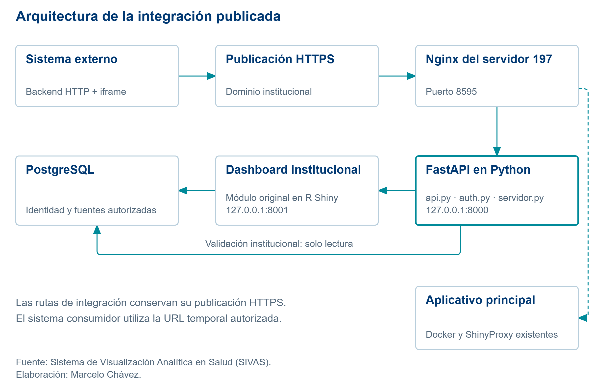
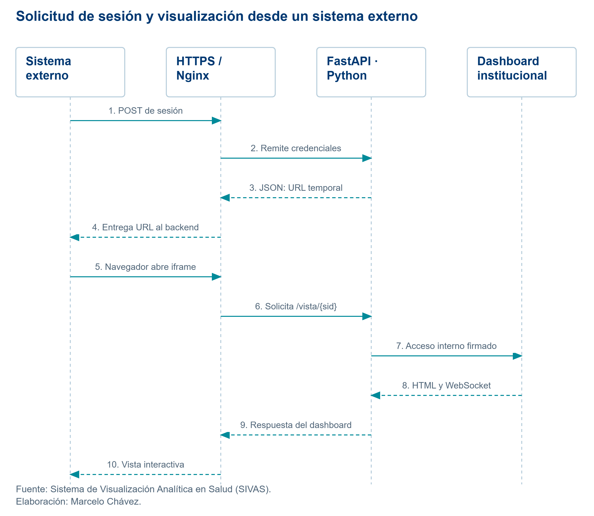
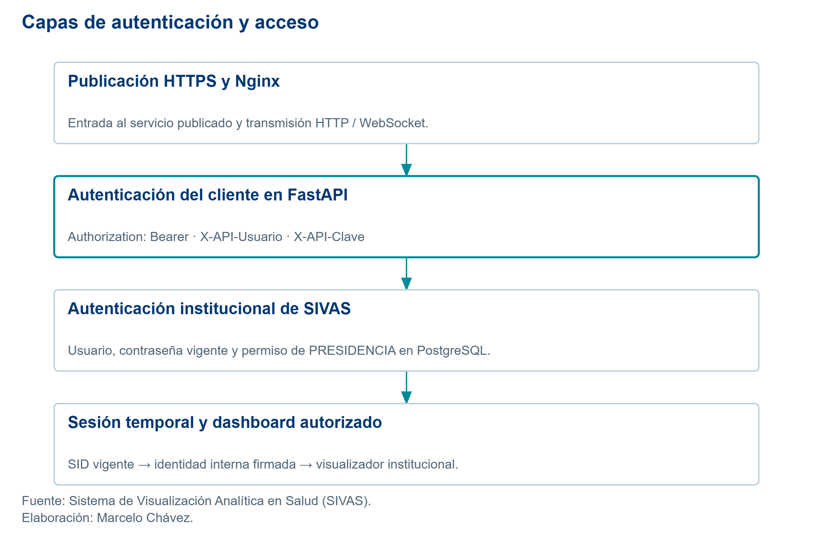
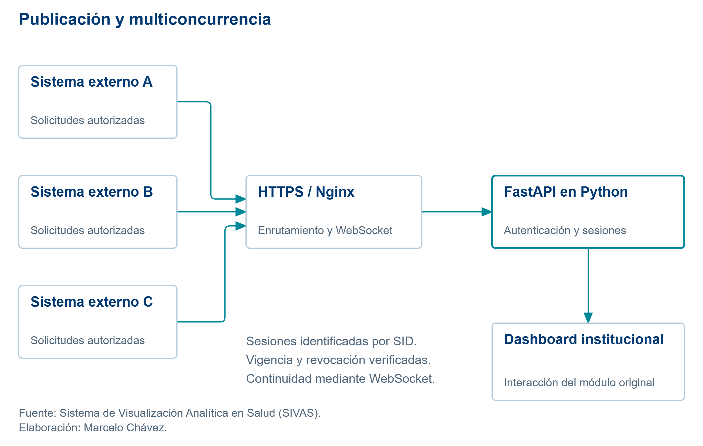
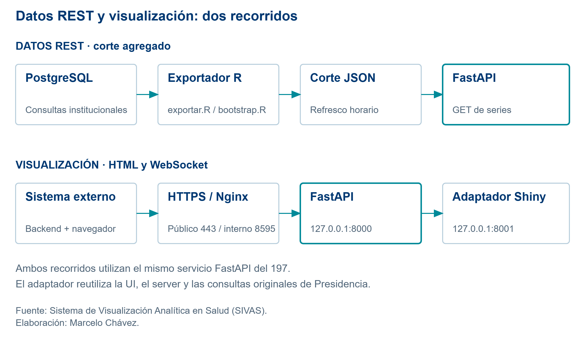

<!-- Elaborado por Marcelo Chávez. Consultor Especialista en Protección Social.
Correo: marcelo_chavez_s@outlook.com. Móvil: 0983332687.
LinkedIn: https://www.linkedin.com/in/marcelochavezec -->

# Antes de empezar {.unnumbered}

Este manual describe la construcción, configuración, publicación y consumo de la API de Indicadores de Presidencia del **Sistema de Visualización Analítica en Salud (SIVAS)**.

El manual reúne construcción, instalación, configuración, publicación, consumo, pruebas y diagnóstico. No es necesario buscar las explicaciones en varios documentos. Los bloques marcados como **código del proyecto** se leen directamente desde los archivos fuente durante el renderizado; los ejemplos con marcadores son didácticos y no contienen secretos.

**Guía de lectura:** si solo desea comprobar el dashboard, vaya al capítulo de consumo de la URL y a la explicación línea por línea de `TEST_API.R`. Si debe mantener el servicio, lea también construcción, instalación Linux y operación. No vuelva a instalar sobre el servidor 10.64.100.197 para aprender: el servicio ya fue publicado; los pasos de instalación describen cómo reproducirlo en un entorno autorizado.

**Alcance:** cinco indicadores de Presidencia. El dashboard sigue desarrollado en **R Shiny** y conserva su diseño. Python administra la API, la autenticación de integración, las sesiones y el acceso al visualizador. No se convirtieron las gráficas a Python y no se integraron otros módulos.

La documentación describe el código local revisado y las verificaciones efectuadas durante esta implementación. El capítulo de pruebas identifica el alcance de cada comprobación y sus condiciones de ejecución.

## Control documental y alcance de esta edición

| Dato | Valor |
|---|---|
| Fecha inicial / portada | 22 de octubre de 2026. |
| Última revisión de contenido y evidencia | 26 de octubre de 2026; horas de los casos en UTC y America/Guayaquil. |
| Versión documental | 2.0, con revisión de contenido del 26/10/2026. No confundir con la versión 1.0.0 declarada por la API. |
| Código incluido | Fuentes locales leídas durante el render. La comparación con el 197 se registra por archivo y SHA256. |
| Operación realizada | Lecturas, sesiones de prueba, consulta y descarga; sin reinstalar, desplegar, sincronizar o reiniciar servicios del 197. |

El anexo de evidencia forma parte de este PDF. Las afirmaciones históricas sin soporte primario completo se identifican como antecedentes; no se reconstruyen horas ni resultados. Las instrucciones de instalación describen cómo reproducir el entorno, no acciones ejecutadas nuevamente sobre producción.

# Instalación y configuración del ecosistema

## Conceptos de API y FastAPI

Una **API** es una interfaz para que un programa solicite una operación o datos a otro programa. En este proyecto, el backend de un sistema externo solicita una sesión autorizada a FastAPI. La API devuelve un JSON con la URL temporal que ese sistema incorpora en un iframe. El ejemplo `TEST_API.R` ilustra este contrato; no limita el lenguaje ni el sistema operativo del consumidor.

**FastAPI** es el framework de Python utilizado para declarar las rutas, validar entradas y respuestas y generar la documentación interactiva. Una ruta combina un método HTTP, como GET o POST, con una dirección. El decorador `@app.post(...)` vincula una ruta con una función Python. Esa relación está documentada en el tutorial oficial de FastAPI [@fastapi].

**Uvicorn** es el programa que escucha conexiones y ejecuta la aplicación FastAPI. Instalar FastAPI no inicia un servicio por sí solo: también se necesita ejecutar Uvicorn y mantenerlo activo. La documentación oficial diferencia la aplicación y el servidor ASGI que la ejecuta [@fastapi-deploy].

En esta implementación, la API nace de la función `create_app()` de \path{deploy/presidencia/api.py}. La instrucción `FastAPI(...)` crea la aplicación. El archivo \path{deploy/presidencia/linux/servidor.py} inicia Uvicorn y le indica que debe llamar a esa función.

## Vocabulario de integración

| Término | Significado en este proyecto |
|---|---|
| Backend | Código del sistema externo o del servicio API que se ejecuta fuera del navegador. |
| Endpoint | Ruta que atiende una operación de la API. |
| GET | Solicitud para leer un recurso o consultar datos. |
| POST | Solicitud para enviar un cuerpo y ejecutar una operación, como crear sesión. |
| JSON | Texto estructurado con nombres y valores que intercambian R y Python. |
| Header | Encabezado HTTP; aquí transporta credenciales de la API. |
| Bearer | Forma de presentar el token: `Authorization: Bearer <token>`. |
| SID | Identificador aleatorio de una sesión temporal de visualización. |
| Iframe | Elemento HTML que muestra otra página dentro de la aplicación consumidora. |
| WebSocket | Conexión persistente que mantiene la interacción del dashboard Shiny. |
| Proxy | Componente que recibe una conexión y la dirige a otro servicio. |
| Loopback | Dirección del mismo equipo: `127.0.0.1`. |
| systemd | Administrador de servicios Linux que inicia y supervisa los procesos. |
| Entorno Conda `msp_01` | Herramientas locales; no es el intérprete de systemd ni el utilizado para pytest en esta revisión. |

## Dónde se ejecuta cada componente

Un **sistema externo** consume la integración a través del dominio `analiticadesalud.msp.gob.ec`. El servicio FastAPI en Python y el visualizador institucional se ejecutan en el servidor Linux `10.64.100.197`; Nginx enruta sus solicitudes. El acceso público utiliza el HTTPS institucional existente. El sistema externo puede ejecutarse en cualquier plataforma con conectividad y autorización para ese dominio.

{#fig-arquitectura width=100%}

El camino de integración de la @fig-arquitectura es:

1. El backend del sistema externo obtiene las credenciales desde su configuración privada.
2. El sistema externo envía una petición HTTPS al dominio institucional.
3. La publicación existente conduce al Nginx del servidor 10.64.100.197, que escucha en 8595.
4. Las rutas de integración se dirigen al FastAPI interno en `127.0.0.1:8000`.
5. FastAPI verifica las credenciales de integración, la cuenta institucional y la sesión; después comunica el acceso firmado al visualizador institucional interno en `127.0.0.1:8001`.
6. Los procesos autorizados consultan PostgreSQL mediante las conexiones institucionales.

El navegador del sistema externo se conecta al dominio por HTTPS. Los puertos 8000 y 8001 son internos del servidor y no son direcciones públicas del iframe. El consumidor tampoco necesita acceso directo a PostgreSQL.

## Dirección pública y direcciones internas

El sistema externo utiliza la URL pública \path{https://analiticadesalud.msp.gob.ec}. La dirección `127.0.0.1:8000` identifica FastAPI solo dentro del servidor 10.64.100.197. La dirección local del ejemplo `TEST_API.R`, \path{http://127.0.0.1:5010/}, pertenece al equipo que ejecuta ese ejemplo.

El valor de `base_url` en el consumidor debe ser el dominio público. Una dirección localhost siempre se refiere al propio equipo que hace la solicitud; por ello no sustituye a la URL publicada del servidor.

## Ubicación del código y preparación

## Directorio del proyecto

En este equipo Windows, la raíz es:

```text
C:/Users/MARCELO/OneDrive/Documentos/MSP/health_analytics_msp
```

En el servidor 10.64.100.197:

```text
/home/marcelo.chavez/PROYECTO_BM/APPs/health_analytics_msp
```

Los comandos que indican **desde la raíz** deben ejecutarse después de situarse en esa carpeta. Un archivo no se encuentra solo por estar abierto en el editor: también importa el directorio de trabajo.

## Mapa de archivos

```text
health_analytics_msp/
  deploy/presidencia/
    api.py                       aplicación FastAPI y endpoints
    auth.py                      autenticación y sesiones
    requirements.txt             dependencias Python fijadas
    configurar.py                preparación privada de desarrollo
    bootstrap.R                  conexiones y corte de datos agregados
    exportar.R                   ejecución del exportador
    bridge.R                     validación HMAC en R
    shiny_app.R                  adaptador al dashboard original
    linux/
      servidor.py                inicia Uvicorn
      sivas-presidencia-api.service
      sivas-presidencia-shiny.service
      sivas-presidencia-exportar.service
      sivas-presidencia-exportar.timer
      nginx-proxy.conf
      nginx-rutas.conf
    examples/shiny_windows/cliente.R
    tests/test_api.py
  modulos/comprobacion_api/
    TEST_API.R                   botón e iframe
    config_credenciales_api.yml   privado; no versionado
  modulos/indicadores_presidencia/
    global.R                     fuentes, reglas y metas
    indicadores_presidencia_ui.R
    indicadores_presidencia_server.R
    indicadores_presidencia_assets.R
  .github/workflows/presidencia-integracion.yml
  docs/manuales/api_presidencia/
    Manual_integral_API_Presidencia.qmd
    bibliography.bib
    _quarto.yml
    incluir_codigo.lua
    latex/                       diseño y créditos
    recursos/                    logos y estilo APA
    diagramas/                   figuras y fuentes editables
```

El exportador de datos se implementa en \path{deploy/presidencia/exportar.R} y el arranque de Python en \path{deploy/presidencia/linux/servidor.py}. La carpeta \path{output/} contiene evidencias y auxiliares locales; no es un componente ejecutable de la API.

## Dependencias y función de cada componente

| Componente | Para qué sirve |
|---|---|
| FastAPI y Pydantic | Rutas, validación y documentación OpenAPI. |
| Uvicorn | Escuchar solicitudes y ejecutar FastAPI. |
| httpx y websockets | Proxy HTTP y comunicación interactiva con Shiny. |
| psycopg | Consulta de identidad en PostgreSQL desde Python. |
| argon2-cffi y PyNaCl | Verificación de contraseñas; no descifrado de hashes. |
| python-dotenv | Lectura de configuración privada en desarrollo. |
| pytest | Pruebas automatizadas de API y seguridad. |
| R, Shiny y paquetes del módulo | Dashboard original y exportación de agregados. |
| Nginx y systemd | Publicación y operación continua en Linux. |

`requirements.txt` fija dependencias; un archivo de requisitos no demuestra por sí solo qué está instalado. En la revisión se consultaron el venv del servicio y los intérpretes locales: FastAPI 0.159.1 y Uvicorn 0.54.0 en ambos venv; Python 3.12.15 en el 197 y 3.12.14 en el venv Windows. Conda `msp_01` tiene Python 3.14.8; R es 4.6.0 en Windows y 4.5.1 en el 197. Las versiones de paquetes y la evidencia están en el anexo. Python 3.14 en CI es configuración del workflow, no prueba de ejecución de esa revisión. No es necesario instalar FastAPI localmente para usar solo el cliente R.

## Instalación Linux: paso 1, comprobar el entorno

**Tipo:** comprobación de prerrequisitos y guía de reproducción; no reinstalación del 197. **Equipo:** Linux, cuenta autorizada del proyecto. **Directorio:** raíz del checkout. **Archivos:** `requirements.txt` y unidades de \path{deploy/presidencia/linux/}. **Propósito:** comprobar intérpretes y puertos antes de una instalación nueva. En otro servidor deben ajustarse usuario, rutas, HTTPS y conectividad. Los comandos siguientes son reproducibles; la evidencia lista cuáles se ejecutaron en esta revisión.

```bash
cd /home/marcelo.chavez/PROYECTO_BM/APPs/health_analytics_msp
python3.12 --version
Rscript --version
ss -ltn | grep -E ':8000|:8001' || true
```

**Resultado esperado:** Python y R disponibles. Antes de iniciar una instalación nueva, 8000 y 8001 deben estar libres. Si el sistema ya está publicado, los listeners en loopback son normales: se debe consultar systemd, no iniciar copias adicionales.

El visualizador reutiliza el módulo institucional. Los paquetes R deben estar disponibles en las bibliotecas del intérprete que utilizará el servicio; esta revisión no instaló ni actualizó ninguno. El siguiente paso distingue el venv realmente usado por systemd del entorno Conda local.

## Paso 2: identificar el intérprete y preparar una reproducción

**Tipo:** guía para un entorno nuevo autorizado. **Equipo:** Linux de desarrollo o servidor de destino nuevo, no el 197 durante esta revisión. **Directorio:** raíz del checkout. **Archivo:** \path{deploy/presidencia/requirements.txt}. **Propósito:** instalar dependencias en el intérprete que después declarará `ExecStart`.

La instalación existente utiliza un **venv**, no Conda, para el proceso de FastAPI. La unidad apunta a \path{/home/marcelo.chavez/.sivas-presidencia/venv/bin/python}; se verificó Python 3.12.15 en esa ruta. En otro equipo, un ejemplo de reproducción es:

```bash
# SOLO instalación nueva; ajustar la raíz de la cuenta autorizada.
python3.12 -m venv /RUTA/PRIVADA/sivas-presidencia/venv
/RUTA/PRIVADA/sivas-presidencia/venv/bin/python -m pip install -r deploy/presidencia/requirements.txt
/RUTA/PRIVADA/sivas-presidencia/venv/bin/python -m pip check
/RUTA/PRIVADA/sivas-presidencia/venv/bin/python -c "import sys; print(sys.executable); print(sys.version)"
```

**Esperado y comprobación:** importación de FastAPI/Uvicorn correcta y dependencias compatibles; `pip check` debe finalizar sin incompatibilidades. Estos comandos de creación/instalación **no se ejecutaron sobre el 197** en esta revisión. El valor absoluto del intérprete debe coincidir con `ExecStart` en la unidad que se instale posteriormente.

Conda `msp_01` es una alternativa de laboratorio y un entorno local de herramientas [@conda]. No se debe presentar como el intérprete instalado de systemd. En Windows se observó \path{C:/ProgramData/anaconda3/envs/msp_01/python.exe}, Python 3.14.8, sin pytest; las pruebas usaron el venv existente de Presidencia, Python 3.12.14. No copiar entornos binarios de Windows a Linux.

```bash
# Lectura de un entorno Conda de laboratorio, si se elige esa alternativa.
conda run -n msp_01 python -c "import sys; print(sys.executable); print(sys.version)"
```

Si se escoge Conda en una futura instalación, debe adaptarse la ruta absoluta de `ExecStart` y repetirse la validación. El manual no afirma que ese cambio ya esté desplegado.

## Paso 3: preparar directorios de ejecución

**Tipo:** instalación nueva, no mantenimiento de carpetas existentes. **Equipo:** Linux autorizado. **Directorio:** raíz del checkout. **Recursos:** runtime de la cuenta, \path{deploy/presidencia/runtime} y \path{/etc/sivas-presidencia}. **Propósito:** separar recursos y configuración privada. **Esperado:** directorios restringidos y rutas compatibles con las unidades; comprobar propietario/permisos mediante `ls -ld`, sin mostrar contenidos privados.

```bash
install -d -m 700 /home/marcelo.chavez/.sivas-presidencia/runtime
install -d -m 700 deploy/presidencia/runtime
sudo install -d -m 700 /etc/sivas-presidencia
```

La primera carpeta almacena el JSON agregado REST. La segunda es necesaria para los recursos de fichas del adaptador. La carpeta de \path{/etc} guarda configuración privada que systemd leerá como administrador. No se guardan esos secretos en los archivos de código.

## Paso 4: configurar credenciales y variables

**Instalación existente:** conservar el archivo \path{/etc/sivas-presidencia/environment} y los secretos vigentes. El usuario institucional autorizado y su contraseña ya existen. No ejecutar `preparar_cuenta.R --generar` para desplegar: ese procedimiento puede cambiar una contraseña.

**Equipo/directorio/archivo:** Linux autorizado, raíz del checkout; archivo privado \path{/etc/sivas-presidencia/environment}. **Propósito:** aprovisionar identidad cliente, firma y conexión por un canal seguro. **Esperado:** configuración válida y privada, sin sobrescribir una existente.

**Primera instalación autorizada:** sustituya \path{/RUTA/DEL/ENTORNO/bin/python} por el intérprete elegido en el paso 2. El siguiente ejemplo genera secretos API nuevos en archivos privados. Se incluye para reproducir la solución; no se ejecutó al redactar este manual. Se niega a reemplazar una configuración existente. No imprime los secretos.

```bash
sudo /RUTA/DEL/ENTORNO/bin/python - <<'PY'
from pathlib import Path
import json, os, secrets
from argon2 import PasswordHasher
os.umask(0o077)
base = Path('/etc/sivas-presidencia')
env = base / 'environment'
cliente = base / 'credenciales_integracion.json'
if env.exists() or cliente.exists():
    raise SystemExit('Ya existe configuración; conservarla o planificar una rotación.')
clave = secrets.token_urlsafe(32)
token = secrets.token_urlsafe(48)
valores = {
    'PRESIDENCIA_API_KEY': token,
    'PRESIDENCIA_CLIENT_USER': 'integracion_presidencia',
    'PRESIDENCIA_CLIENT_HASH': PasswordHasher().hash(clave),
    'PRESIDENCIA_BRIDGE_KEY': secrets.token_urlsafe(48),
    'PRESIDENCIA_SIVAS_USER': '<USUARIO_INSTITUCIONAL_AUTORIZADO>',
    'PRESIDENCIA_ENVIRONMENT': 'producción',
    'PRESIDENCIA_VIEW_SECONDS': '28800',
    'PRESIDENCIA_SNAPSHOT': '/home/marcelo.chavez/.sivas-presidencia/runtime/presidencia.json',
    'PRESIDENCIA_SHINY_HOST': '127.0.0.1',
    'PRESIDENCIA_SHINY_PORT': '8001',
    'PRESIDENCIA_SHINY_INTERNAL_URL': 'http://127.0.0.1:8001',
    'PRESIDENCIA_SHINY_PUBLIC_URL': 'http://127.0.0.1:8001',
    'PRESIDENCIA_ALLOWED_HOSTS': 'analiticadesalud.msp.gob.ec,127.0.0.1,localhost',
    'PRESIDENCIA_FRAME_ANCESTORS': "'self' http://127.0.0.1:5010 http://localhost:5010 http://127.0.0.1:18760 http://localhost:18760",
    'PRESIDENCIA_MAX_AGE_HOURS': '24',
    'PRESIDENCIA_DOCS_URL': '/presidencia-api/docs',
    'PRESIDENCIA_OPENAPI_URL': '/presidencia-api/openapi.json',
    'PRESIDENCIA_HEALTH_PUBLIC_PREFIX': '/presidencia-api',
    'PGHOST': '', 'PGPORT': '5432', 'PGUSER': '',
    'PGPASSWORD': '', 'PGSSLMODE': 'prefer'
}
env.write_text('\n'.join(k+'='+json.dumps(v, ensure_ascii=False)
                        for k,v in valores.items())+'\n', encoding='utf-8')
cliente.write_text(json.dumps({'usuario_api':'integracion_presidencia',
    'clave_api':clave,'token':token}, ensure_ascii=False, indent=2), encoding='utf-8')
print('Archivos privados preparados. Completar conexión PostgreSQL por canal seguro.')
PY
sudoedit /etc/sivas-presidencia/environment
sudo chmod 600 /etc/sivas-presidencia/environment
```

En el editor privado completar PGHOST, PGUSER y PGPASSWORD con la conexión autorizada. No pegar esas claves en comandos que queden en el historial. La cuenta institucional de la instalación debe existir y tener permiso para PRESIDENCIA; escribir su nombre en un archivo no crea ese permiso.

El archivo adicional de credenciales API generado sirve para aprovisionar al consumidor mediante un canal seguro. No contiene la contraseña institucional. La clave HMAC, el hash del cliente y la contraseña PostgreSQL no se entregan al usuario del iframe.

`EnvironmentFile` es configuración leída por systemd; no es un script Bash. Evitar cargarlo con `source`, especialmente porque los hashes contienen signos de dólar. En el checkout Linux publicado no se copió el `.env` de Windows: `bootstrap.R` lo leería si existiera y podría sustituir variables de producción.

## Variables: finalidad y tratamiento

Los nombres siguientes proceden del código. Los secretos se muestran con marcadores; nunca copiar valores reales al manual o a Git. La existencia de una variable documentada no acredita que un valor de ejemplo esté instalado.

| Variable o grupo | Función | Valor observado o tratamiento |
|---|---|---|
| \path{PRESIDENCIA_API_KEY} | Bearer del cliente de integración. | `<TOKEN_PRIVADO>`; no se imprime. |
| \path{PRESIDENCIA_CLIENT_USER}, \path{PRESIDENCIA_CLIENT_HASH} | Identidad del cliente y verificación de su clave. | Usuario configurado y hash privado; el consumidor suministra su clave, no el hash. |
| \path{PRESIDENCIA_SIVAS_USER} | Cuenta institucional específica permitida. | `<USUARIO_AUTORIZADO>`; necesita asignación vigente a PRESIDENCIA. |
| \path{PRESIDENCIA_BRIDGE_KEY} | HMAC interno API → adaptador. | `<CLAVE_INTERNA_PRIVADA>`; no se entrega al iframe. |
| \path{PRESIDENCIA_VIEW_SECONDS} | Vencimiento absoluto de SID. | 28800 s observados; ocho horas configuradas, no duración real ensayada. |
| \path{PRESIDENCIA_SNAPSHOT}, \path{PRESIDENCIA_MAX_AGE_HOURS} | Corte REST y vigencia máxima admitida. | Runtime privado del servicio; 24 h observadas. |
| \path{PRESIDENCIA_SHINY_INTERNAL_URL} | Destino del proxy HTTP/WSS. | \path{http://127.0.0.1:8001} en el 197. |
| \path{PRESIDENCIA_SHINY_PUBLIC_URL} | Nombre histórico usado como destino/fallback por el código. | No confundirlo con la URL pública del iframe; esta se devuelve en el POST bajo el dominio institucional. |
| \path{PRESIDENCIA_SHINY_HOST}, \path{PRESIDENCIA_SHINY_PORT} | Escucha del adaptador. | Socket observado en loopback, puerto 8001. |
| \path{PRESIDENCIA_ALLOWED_HOSTS}, \path{PRESIDENCIA_FRAME_ANCESTORS} | Hosts admitidos y orígenes que pueden embeber. | Configuración explícita; 5010 se probó. No usar comodines para simular aprobación de otros sistemas. |
| \path{PRESIDENCIA_DOCS_URL}, \path{PRESIDENCIA_OPENAPI_URL} | Rutas de Swagger y del contrato. | \path{/presidencia-api/docs} y \path{/presidencia-api/openapi.json}, verificadas. |
| \path{PRESIDENCIA_HEALTH_PUBLIC_PREFIX} | Prefijo de enlaces públicos de salud. | Rutas observadas bajo \path{/presidencia-api/health/}. |
| \path{PGHOST}, \path{PGPORT}, \path{PGSSLMODE} | Conectividad PostgreSQL del servidor. | \path{10.64.100.191:5432}; modo prefer observado. Eso no certifica por sí solo cifrado efectivo de la conexión PostgreSQL. |
| \path{PGUSER}, \path{PGPASSWORD} | Credenciales de consulta institucional. | `<USUARIO_BD>` / `<CLAVE_BD>`; privadas. |
| \path{SIVAS_DEV_CONFIG}, \path{R_LIBS_USER} | Alternativas de configuración/bibliotecas R. | Opcionales según el código; no reemplazar el environment del servicio con un archivo local. |

La clave institucional del consumidor se envía en `clave_sivas` durante el POST; no se almacena en el entorno del iframe. El SID es una capacidad temporal y se debe eliminar de logs y capturas compartidas. También se depuraron cookies de mensajes de error de las herramientas.

## Paso 5: instalar y arrancar los servicios

**Tipo:** guía de instalación nueva; los comandos que instalan, habilitan o arrancan servicios no se ejecutaron en el 197 durante esta revisión. **Archivos:** las cuatro unidades y el temporizador de \path{deploy/presidencia/linux/}. **Propósito:** supervisar API, adaptador y exportación con el intérprete configurado. **Esperado:** verificación de unidades correcta, exportación exitosa y procesos activos. La instalación existente se comprobó únicamente con consultas de estado y lectura de archivos.

**Dónde:** Linux, desde la raíz del proyecto. Revisar primero las rutas y usuario escritos en las unidades. La unidad systemd describe qué proceso se supervisa y bajo qué condiciones [@systemd].

```bash
sudo install -m 644 deploy/presidencia/linux/sivas-presidencia-*.service /etc/systemd/system/
sudo install -m 644 deploy/presidencia/linux/sivas-presidencia-exportar.timer /etc/systemd/system/
sudo systemd-analyze verify /etc/systemd/system/sivas-presidencia-*.service
sudo systemctl daemon-reload
sudo systemctl start sivas-presidencia-exportar.service
sudo systemctl enable --now sivas-presidencia-shiny.service
sudo systemctl enable --now sivas-presidencia-api.service
sudo systemctl enable --now sivas-presidencia-exportar.timer
```

El orden tiene una finalidad: primero comprobar que se puede generar el corte, después levantar el dashboard, luego la API y finalmente activar el refresco horario. Si el exportador falla, resolver la conexión o los datos antes de declarar disponible la integración.

Las unidades usan una cuenta de servicio existente, `NoNewPrivileges`, `PrivateTmp`, `ProtectSystem=strict`, máscara 0077 y rutas de escritura limitadas. No se modificó SELinux en esta revisión ni se prescribe deshabilitarlo para reproducir la integración. Su estado actual no se utilizó como evidencia de funcionamiento.

## Paso 6: comprobar antes de publicar

**Tipo:** comprobación de lectura. **Equipo:** Linux donde corran los servicios; `127.0.0.1` identifica ese equipo. **Directorio:** raíz del checkout. **Componentes:** rutas de salud y sockets de API/Shiny. **Propósito:** separar disponibilidad del proceso de autenticación e interactividad. Las rutas públicas verificadas desde Windows se registran en el anexo; no se presume que todo comando de esta guía fue ejecutado.

```bash
curl -f http://127.0.0.1:8000/health/live
curl -f http://127.0.0.1:8000/health/ready
curl -f http://127.0.0.1:8000/health/shiny
ss -ltn | grep -E ':8000|:8001'
sudo systemctl is-active sivas-presidencia-api sivas-presidencia-shiny
```

**Resultado esperado:** respuestas de salud correctas y puertos únicamente en loopback. Esto aún no prueba autenticación, gráficos, descarga o WebSocket. La publicación HTTPS y las pruebas de consumo se explican más adelante.

## Comprobación de dependencias R del adaptador

**Tipo:** preflight de lectura para una reproducción. **Equipo/directorio:** Linux de destino autorizado, raíz del checkout. **Archivos:** `bootstrap.R`, `shiny_app.R` y UI/server/global/assets del módulo. **Propósito:** comprobar las bibliotecas que realmente cargará R. **Esperado:** lista vacía de faltantes; si no, aprovisionar el entorno de laboratorio mediante el procedimiento institucional, no instalar automáticamente en el 197.

```r
paquetes <- c("shiny", "dplyr", "highcharter", "glue", "gt", "shinyjs",
              "DBI", "RPostgres", "config", "jsonlite", "digest", "openxlsx")
faltantes <- paquetes[!vapply(paquetes, requireNamespace, logical(1), quietly = TRUE)]
print(faltantes)
```

Para ejecutar el adaptador en un laboratorio, configurar allí sus variables privadas y usar `Rscript deploy/presidencia/shiny_app.R`; debe escuchar en el host/puerto configurado. En el 197 no se lanzó otra copia: se inspeccionó el servicio existente. La lectura de \path{/health/shiny} acredita respuesta HTTP; la prueba de iframe/WSS del anexo acredita el recorrido interactivo observado.

## Preparación del sistema consumidor

El sistema consumidor necesita un cliente HTTP en su backend y un componente capaz de mostrar un iframe. Puede estar escrito en R, Python, Java, .NET u otra tecnología. El ejemplo `TEST_API.R` usa una instalación R ya disponible; su finalidad es demostrar el contrato HTTPS y la inserción del iframe, no instalar un ecosistema nuevo.

# Construcción de FastAPI en Python

## Paso 1: definir los datos que se aceptan

Archivo: \path{deploy/presidencia/api.py}. Este es el modelo real del cuerpo del POST:

```{.python fuente="deploy/presidencia/api.py" desde="80" hasta="84"}
```

`BaseModel` establece el contrato. `extra='forbid'` rechaza campos no previstos. `usuario_sivas` y `clave_sivas` son obligatorios y tienen longitudes máximas. `SecretStr` evita que la contraseña aparezca normalmente como texto claro al representar el modelo, aunque la verificación necesita extraerla dentro del backend. `indicador` tiene un valor inicial y solo admite los cinco identificadores autorizados.

No se debe enviar el JSON completo de un archivo de credenciales si también contiene campos como fecha o procedencia. Enviar únicamente los campos del contrato.

## Paso 2: crear la aplicación

Archivo: `api.py`, función `create_app`. Este fragmento real crea FastAPI y declara sus tres entradas de autenticación API:

```{.python fuente="deploy/presidencia/api.py" desde="87" hasta="118"}
```

La variable `app` es la aplicación. Las variables de entorno determinan el nombre del ambiente y las rutas de Swagger/OpenAPI. `TrustedHostMiddleware` restringe los nombres de host aceptados. `HTTPBearer` lee Authorization; las dos instancias `APIKeyHeader` leen usuario y clave API.

La función es una **fábrica**: primero prepara la aplicación y finalmente la devuelve. Por eso Uvicorn se inicia con `factory=True` o `--factory`. No basta con importar el archivo y esperar que aparezca una página pública.

## Paso 3: validación de acceso a los endpoints

Archivo: `api.py`, función `authorize`. El decorador del POST incluye `Depends(authorize)`: FastAPI ejecuta esa comprobación antes de entregar el control a la función que crea la sesión.

```{.python fuente="deploy/presidencia/api.py" desde="120" hasta="135"}
```

Primero se revisa el límite de intentos; después se compara el Bearer y se verifica el cliente. También se comprueba que la cuenta institucional configurada conserve autorización. Un error de acceso devuelve 401; una indisponibilidad de la fuente de identidad devuelve 503. El limitador actual cuenta fallos por origen durante un minuto; no es una prueba de capacidad o un sistema completo de protección perimetral.

## Paso 4: declarar el POST de sesiones

Ubicación exacta: \path{deploy/presidencia/api.py}, línea 201 declara el prefijo; línea 203 registra `POST /api/v1/presidencia/sesiones`; desde la línea 204, `open_session()` recibe el cuerpo validado. Cualquier backend externo puede llamar este endpoint. `TEST_API.R` es uno de esos consumidores:

```{.python fuente="deploy/presidencia/api.py" desde="201" hasta="219"}
```

1. `prefix` aporta \path{/api/v1/presidencia}.
2. `@app.post` agrega \path{/sesiones} y vincula esa URL con `open_session`.
3. `body` contiene el JSON validado; `request` contiene información de la petición.
4. `gate.issue(...)` valida usuario y contraseña institucionales y crea el SID.
5. `request.base_url` se utiliza para construir la dirección HTTPS pública. Nginx debe comunicar correctamente el esquema y host.
6. El `return` entrega un diccionario; FastAPI lo convierte en una respuesta JSON. No devuelve el dashboard como una imagen.

## Paso 5: obtener datos REST

`catalog()` devuelve el catálogo de cinco indicadores y los nombres de sus rutas. La dirección de dashboard que aparece en ese catálogo incluye un marcador de sesión: para visualizar se debe crear una sesión real mediante el POST.

`series()` devuelve una serie agregada y admite `anio`, `mes_desde` y `mes_hasta`. En la implementación documentada el año admitido es **2026**. Un rango mensual invertido se rechaza con 422. No asumir que cambiar el año en la URL habilita automáticamente datos de 2027.

Ubicación exacta: \path{deploy/presidencia/api.py}, línea 290 registra `GET /api/v1/presidencia` y línea 296 registra `GET /api/v1/presidencia/{indicator_id}/serie`. Ambas rutas ejecutan `authorize` y leen el corte mediante `read_snapshot()`.

```{.python fuente="deploy/presidencia/api.py" desde="290" hasta="306"}
```

Los GET protegidos requieren los tres encabezados API y la cuenta configurada debe continuar autorizada. La contraseña institucional se verifica al crear la sesión de visualización; no se envía como parámetro GET.

## Paso 6: devolver el visualizador y conservar interacción

La ruta \path{/vista/<sid>/embed/presidencia} valida la capacidad y devuelve una página HTML. Esa página contiene un iframe interno con una ruta \path{/vista/<sid>/shiny/}. FastAPI actúa como proxy hacia el Shiny de 8001.

```{.python fuente="deploy/presidencia/api.py" desde="308" hasta="317"}
```

`shiny_http()` reenvía HTML, recursos y solicitudes HTTP autorizadas. `shiny_websocket()` mantiene los mensajes de interacción y comprueba la sesión cada diez segundos. Sin este segundo canal el dashboard puede mostrar una portada y luego quedar desconectado o sin responder.

El contenido sigue calculándose y renderizándose en Shiny. El proxy no reemplaza el server R ni sus consultas por una captura estática.

## Paso 7: iniciar Python con Uvicorn

Archivo completo: \path{deploy/presidencia/linux/servidor.py}.

```{.python fuente="deploy/presidencia/linux/servidor.py"}
```

Las importaciones cargan logging, expresiones regulares y Uvicorn. `OcultarSesion` modifica los mensajes antes de escribirlos para no conservar SIDs de 43 caracteres en las rutas. No modifica el SID que utiliza el navegador.

El bloque `if __name__ == '__main__'` se ejecuta al iniciar el módulo con Python. La cadena `deploy.presidencia.api:create_app` significa: buscar el paquete `deploy`, luego `presidencia`, importar `api.py` y llamar a `create_app`.

`host='127.0.0.1'` mantiene el puerto interno. `port=8000` fija el puerto. `workers=1` es importante: las sesiones se almacenan en memoria de un único proceso. `access_log=False` reduce el registro de URLs. Solo se confían encabezados de proxy provenientes de loopback.

La ejecución Linux real es:

```bash
python -m deploy.presidencia.linux.servidor
```

Debe usarse el intérprete declarado por la unidad: en el 197 es el venv nativo documentado, con las variables privadas que carga systemd. Conda solo es una alternativa de laboratorio si se elige y configura expresamente. No ejecutar otra copia en 8000 mientras el servicio existente esté activo.

# Autenticación, sesiones y capas de seguridad

## Los dos niveles de autenticación

El primer nivel identifica al **cliente API** mediante usuario, contraseña API y Bearer. El segundo comprueba al **usuario institucional** que tiene permiso para PRESIDENCIA. Tener un token API correcto no sustituye la contraseña institucional al crear la sesión.

{#fig-secuencia width=100%}

La @fig-secuencia presenta el orden de integración. El backend del sistema externo envía el POST con las credenciales y recibe la URL temporal. Después su navegador abre esa URL dentro del iframe y mantiene la conexión con el visualizador autorizado.

## Validación del archivo auth.py

Ruta en el repositorio: \path{deploy/presidencia/auth.py}. Este archivo contiene `PostgresIdentity`, `verify_institutional_password` y `Gateway`. La consulta `SQL_IDENTITY` verifica actividad, vigencia y asignación al módulo; `verify_client()` valida la identidad API; `issue()` comprueba la contraseña institucional y crea la sesión. El anexo presenta cada línea del archivo junto con su explicación.

`PostgresIdentity` consulta `productos_bm.credenciales.usuarios`, `usuario_modulo`, `modulos` y `roles`. La consulta está parametrizada. Exige usuario activo y vigente, asignación activa a PRESIDENCIA y rol USUARIO o ADMINISTRADOR; la cuenta no debe ser superusuario. No crea usuarios, migra tablas o cambia permisos.

El hash institucional no se devuelve al sistema consumidor. Las contraseñas scrypt se verifican mediante PyNaCl y las Argon2 mediante PasswordHasher. **Verificar un hash no significa recuperar la contraseña original.**

`Gateway.verify_client()` comprueba al cliente API; `issue()` genera la sesión; `resolve()` revisa vigencia y cambios de identidad; `revoke()` elimina la capacidad y `headers()` firma la identidad que recibirá R. El apéndice contiene `auth.py` completo.

## Diferenciar secretos y URL temporal

| Elemento | Duración y destino |
|---|---|
| Bearer API | Permanente y revocable; solo backend consumidor y servicio API. |
| Contraseña API | Backend consumidor; en el servicio se conserva su hash. |
| Contraseña institucional | Backend consumidor; se verifica contra el hash institucional. |
| Clave HMAC | Solo comunicación interna FastAPI-Shiny; no se entrega al consumidor. |
| SID de iframe | Temporal; aparece en la URL y permite visualizar mientras esté vigente. |

La sesión dura por defecto 28.800 segundos: ocho horas. No se prolonga con actividad. El cliente mínimo solicita otra sesión al pulsar nuevamente el botón, pero no revoca las anteriores al cerrarse. Estas vencen según el servicio. Un reinicio de FastAPI pierde sus sesiones en memoria.

El gateway limita el registro a 256 sesiones vigentes. El valor controla la admisión de sesiones en memoria; la planificación de capacidad utiliza las mediciones operativas del entorno. La cuenta y su huella de contraseña se revalidan cada diez segundos de uso, y el WebSocket también revisa la vigencia periódicamente.

## Controles y dónde se aplican

{#fig-seguridad width=100%}

La @fig-seguridad separa los controles de transporte, credenciales, capacidad temporal, puente interno y datos. Las transacciones de consulta utilizan modo de solo lectura; esta configuración no reemplaza la revisión de permisos del rol de base de datos [@postgres].

La política CSP `frame-ancestors` decide qué páginas pueden incrustar el contenido. El origen incluye **protocolo, host y puerto**. \path{http://127.0.0.1:5010} y \path{http://127.0.0.1:18760} son orígenes distintos. La especificación CSP establece el control de ancestros del marco [@csp].

Se autorizaron explícitamente 127.0.0.1 y localhost en los puertos 5010 y 18760, además del propio sitio. No se utiliza un comodín. Las llamadas POST desde el backend del sistema externo no requieren CORS del navegador; esto es diferente del permiso para mostrar un iframe.

# Datos y conexión con el dashboard R

## Fuentes institucionales de datos

Las consultas y metas se reutilizan de \path{modulos/indicadores_presidencia/global.R} [@sivas]. Las fuentes leídas por esta implementación son:

| Base | Esquema y tabla | Uso |
|---|---|---|
| kpis | `public.indicador_primer_nivel` | Cobertura del primer nivel. |
| kpis | `public.indicador_salud_mental` | Cobertura de salud mental. |
| kpis | `public.indicador_paquete_ninos` | Paquete priorizado de niños. |
| kpis | `public.indicador_gestantes` | Paquete priorizado de gestantes. |
| productos_bm | `presidencia.medicamentos` | Abastecimiento de medicamentos. |
| productos_bm | `credenciales.*` | Identidad y autorización institucional. |

El sistema externo no consulta estas tablas. `bootstrap.R` crea conexiones de lectura para R; `auth.py` utiliza su conexión de lectura para identidad.

## Exportación del corte autorizado

`exportar.R` llama a `presidencia_exportar()`, que une los datos y las metas institucionales y escribe un JSON agregado. Cada conjunto contiene fecha, mes, valor, meta mensual, numeradores, denominador, corte y actualización. No se exportan cédulas o nombres de pacientes.

El temporizador Linux está configurado con `OnUnitActiveSec=1h` para regenerar el corte aproximadamente cada hora. Se comprobó su estado y última ejecución, no una serie prolongada de ciclos. REST lo lee y valida su estructura, cinco indicadores, año, fechas y antigüedad máxima de 24 horas. Un corte vencido o inválido genera 503. En Linux, el archivo final se sustituye mediante renombrado atómico para que una lectura concurrente no encuentre un JSON incompleto.

El dashboard Shiny mantiene sus consultas originales; REST y el iframe son consumos distintos. El anexo contrasta ambas salidas y Excel en una muestra real. `ready` comprueba la antigüedad del archivo agregado, no que todos los indicadores tengan datos del último mes de negocio. En la muestra, primer nivel/salud mental llegan a junio; paquetes a septiembre y medicamentos a agosto de 2026. No se alteraron fuentes para completar períodos ausentes.

## Acceso directo mediante identidad firmada

`shiny_app.R` carga la UI y el server originales, retira el panel de login solo de esta instancia adaptadora y suministra una identidad externa verificada. Antes de mostrarla exige la firma interna de FastAPI. No se eliminó el login del SIVAS convencional.

La firma se calcula con HMAC-SHA256. Incluye usuario, módulo, tiempo y SID. R verifica que corresponda a PRESIDENCIA, a la cuenta autorizada y a una ventana temporal de 60 segundos. El acceso directo al adaptador sin esa firma no entrega el dashboard protegido.

Archivo real: \path{deploy/presidencia/bridge.R}.

```{.r fuente="deploy/presidencia/bridge.R"}
```

# Publicación y multiconcurrencia

## Publicación del código en GitHub y despliegue de servicios

La publicación del código se realiza en GitHub. Para ejecutar esa versión en el servidor se configura el intérprete, las dependencias, las variables privadas, las unidades systemd y las rutas de Nginx. Los pasos siguientes describen esa configuración operativa.

La integración publicada utiliza servicios nativos Linux. Se conservan Docker y ShinyProxy para el aplicativo convencional, pero no se agregaron contenedores de Presidencia. Los Dockerfile y compose del directorio de integración son alternativas de desarrollo y CI; no describen el modo de ejecución que se dejó activo en el servidor 10.64.100.197.

## Paso 1: comprender las rutas de Nginx

El archivo \path{linux/nginx-rutas.conf} agrega únicamente los endpoints de integración. El resto de las rutas mantiene su destino convencional.

```{.nginx fuente="deploy/presidencia/linux/nginx-rutas.conf"}
```

El primer bloque atiende exactamente el catálogo. El segundo permite sus rutas hijas, como sesiones y series. El bloque \path{/vista/} conduce el HTML y WebSocket del dashboard temporal. Swagger y OpenAPI tienen nombres propios para no sustituir otras páginas de SIVAS.

La ruta pública de salud empieza por \path{/presidencia-api/health/}. El rewrite la adapta a \path{/health/} antes de pasarla a Python. OpenAPI se configura con el prefijo público para que el botón de prueba de Swagger no intente consultar una ruta equivocada.

## Paso 2: comprender el proxy y WebSocket

Archivo real: \path{linux/nginx-proxy.conf}.

```{.nginx fuente="deploy/presidencia/linux/nginx-proxy.conf"}
```

`proxy_pass` entrega las peticiones a 8000, no a Shiny directamente. `Host` y `X-Forwarded-Proto` permiten generar URLs públicas correctas. El valor HTTPS se usa porque estas rutas se publican mediante el frontal HTTPS institucional existente; no representa la instalación de un certificado nuevo en este fragmento.

Los encabezados Upgrade y Connection mantienen la transición a WebSocket, que Nginx requiere reenviar expresamente [@nginx]. En el servidor 10.64.100.197 ya existe el mapa `connection_upgrade_analytics_msp` en su configuración. En una reproducción nueva debe existir en el contexto HTTP:

```nginx
map $http_upgrade $connection_upgrade_analytics_msp {
    default upgrade;
    '' close;
}
```

No duplicar un mapa que ya existe. Las directivas de encabezados del location evitan heredar el SAMEORIGIN del aplicativo convencional; FastAPI aporta su lista explícita de ancestros permitidos. No se quitaron las protecciones de todas las interfaces.

## Paso 3: instalar las rutas sin reemplazar SIVAS

**Tipo:** reproducción de una instalación nueva o futuro despliegue autorizado; no ejecutado en esta revisión. **Equipo:** Linux con administración de Nginx. **Directorio:** raíz del checkout. **Archivos:** las dos plantillas de \path{deploy/presidencia/linux/}, sus includes en \path{/etc/nginx/} y la configuración del server 8595. **Propósito:** enrutar únicamente la integración. En el 197 se comprobó por lectura la inclusión en \path{/etc/nginx/conf.d/analytics-shinyproxy-8595.conf}, línea 96; no se editó ni recargó. Los comandos siguientes son instrucciones, no evidencia de haberlos ejecutado.

```bash
sudo cp /etc/nginx/conf.d/analytics-shinyproxy-8595.conf /etc/nginx/conf.d/analytics-shinyproxy-8595.conf.respaldo
sudo install -m 644 deploy/presidencia/linux/nginx-proxy.conf /etc/nginx/sivas-presidencia-proxy.conf
sudo install -m 644 deploy/presidencia/linux/nginx-rutas.conf /etc/nginx/sivas-presidencia-rutas.conf
sudoedit /etc/nginx/conf.d/analytics-shinyproxy-8595.conf
```

Agregar dentro del server 8595, antes del `location /` convencional:

```nginx
include /etc/nginx/sivas-presidencia-rutas.conf;
```

Después:

```bash
sudo nginx -t
sudo systemctl reload nginx
```

**Resultado esperado:** `nginx -t` confirma sintaxis correcta; la recarga aplica la nueva configuración. No reinicia Docker ni ShinyProxy. Si la validación falla, no recargar: restaurar el archivo respaldado o corregir el error concreto.

## Paso 4: verificar el acceso público

**Dónde:** PowerShell Windows, sin credenciales para las rutas de salud.

```powershell
Invoke-RestMethod 'https://analiticadesalud.msp.gob.ec/presidencia-api/health/live'
Invoke-RestMethod 'https://analiticadesalud.msp.gob.ec/presidencia-api/health/ready'
Invoke-RestMethod 'https://analiticadesalud.msp.gob.ec/presidencia-api/health/shiny'
```

`live` comprueba que el proceso atiende; `ready` que el corte REST está disponible y vigente; `shiny` que el adaptador HTTP responde. Estas comprobaciones no reemplazan el POST autenticado ni una prueba interactiva del iframe.

## Configuración de las unidades systemd

La unidad de la API es el vínculo entre Linux y el Python que se construyó:

```{.ini fuente="deploy/presidencia/linux/sivas-presidencia-api.service"}
```

`WorkingDirectory` sitúa el proceso en la raíz del proyecto. `EnvironmentFile` carga la configuración privada. `ExecStart` elige el Python aislado y ejecuta `servidor.py` como módulo. `Restart=on-failure` reinicia el proceso si falla; no conserva las sesiones que estaban en su memoria. Las últimas directivas restringen privilegios y escritura.

La unidad Shiny ejecuta `Rscript deploy/presidencia/shiny_app.R`. El exportador es una tarea `oneshot`: termina al producir el corte. El timer lo invoca cada hora, por lo que verlo inactivo después de una ejecución correcta es normal; lo que debe estar activo para repetirlo es el temporizador.

## Iniciar, detener, reiniciar y actualizar

**Consultar:**

```bash
sudo systemctl status sivas-presidencia-api sivas-presidencia-shiny
sudo systemctl list-timers sivas-presidencia-exportar.timer
sudo systemctl show sivas-presidencia-exportar.service -p ExecMainStatus
```

**Actualizar solo los datos REST:**

```bash
sudo systemctl start sivas-presidencia-exportar.service
```

**Reiniciar únicamente la integración después de un cambio autorizado:**

```bash
sudo systemctl restart sivas-presidencia-shiny.service sivas-presidencia-api.service
```

Esto desconecta los visualizadores de integración y obliga a solicitar nuevas sesiones. No hace falta reiniciar ambos si solo se cambió la lista CSP: en ese caso reiniciar únicamente la API.

**Detener la integración:**

```bash
sudo systemctl stop sivas-presidencia-exportar.timer sivas-presidencia-api.service sivas-presidencia-shiny.service
```

Las rutas públicas seguirán presentes mientras no se retiren de Nginx; mostrarán indisponibilidad si sus procesos están detenidos. Detener systemd no desinstala archivos ni elimina credenciales.

## Consulta de registros operativos

```bash
sudo journalctl -u sivas-presidencia-api.service --since '10 minutes ago'
sudo journalctl -u sivas-presidencia-shiny.service --since '10 minutes ago'
sudo journalctl -u sivas-presidencia-exportar.service -n 30
```

La API redacta SID en sus rutas de registro; Nginx no registra access_log de la integración y sus errores se limitan a nivel crítico. Los registros operativos siguen siendo información de acceso restringido. No compartirlos sin revisión.

## Gestión de sesiones y conexiones simultáneas

{#fig-concurrencia width=100%}

La @fig-concurrencia muestra cómo entran solicitudes simultáneas desde sistemas externos al mismo servicio publicado. Nginx recibe las conexiones; FastAPI atiende las operaciones HTTP y las sesiones autorizadas; el visualizador mantiene la interacción del dashboard mediante WebSocket. El aplicativo principal continúa con su despliegue existente.

Las sesiones de visualización se conservan en la memoria del proceso FastAPI configurado en `servidor.py`. El gateway valida vencimiento, revocación y el límite configurado de sesiones. Al planificar réplicas o trabajadores adicionales, se debe conservar una resolución coherente del SID mediante afinidad o almacenamiento compartido. El control operativo revisa conexiones PostgreSQL, CPU, memoria, tiempos HTTP y continuidad de WebSocket. Las cifras de capacidad se obtienen del procedimiento de pruebas del entorno autorizado.

## CI y despliegue del repositorio

Archivo: \path{.github/workflows/presidencia-integracion.yml}. Cuando cambian las rutas contempladas, GitHub Actions instala dependencias Python, ejecuta pytest y construye una imagen API de desarrollo. Un disparo manual puede empaquetar esa imagen y, opcionalmente, construir Shiny.

El workflow no contiene un despliegue automático al servidor 10.64.100.197 ni aprovisionamiento de sus secretos. La instalación nativa documentada es una operación distinta. El código copiado mediante Git debe coincidir con el publicado, y los secretos deben conservarse fuera de Git.

# Consumo de la URL

## Direcciones que debe conocer

| Función | URL o ruta |
|---|---|
| Base del cliente | \path{https://analiticadesalud.msp.gob.ec} |
| Swagger | \path{/presidencia-api/docs} |
| Catálogo REST | \path{/api/v1/presidencia} |
| Crear sesión | `POST /api/v1/presidencia/sesiones` |
| Serie de un indicador | \path{/api/v1/presidencia/<id>/serie} |
| Ejemplo de comprobación `TEST_API.R` | \path{http://127.0.0.1:5010/} |

Las rutas de la tabla, salvo la prueba local, se agregan a la base HTTPS. Los cinco IDs válidos son `primer-nivel`, `salud-mental`, `paquete-ninos`, `paquete-gestantes` y `medicamentos`.

## Configurar el YAML privado

Archivo del ejemplo `TEST_API.R`: \path{modulos/comprobacion_api/config_credenciales_api.yml}. Esta es su estructura **sin secretos reales**:

```yaml
servicio:
  base_url: https://analiticadesalud.msp.gob.ec
  timeout_segundos: 30
fastapi:
  usuario: integracion_presidencia
  clave: '<CONTRASEÑA_API_PRIVADA>'
  token: '<BEARER_PRIVADO>'
sivas:
  usuario: daniel.azin.0698
  clave: '<CONTRASEÑA_INSTITUCIONAL_PRIVADA>'
```

Los marcadores no son credenciales funcionales. El archivo privado existente ya se completó durante la implementación. No cambiar sus valores para resolver un error de puerto o de CSP.

La configuración privada de desarrollo de la integración utiliza también este archivo, excluido del repositorio:

```text
deploy/presidencia/runtime/credenciales_integracion.json
```

La contraseña institucional privada está en `credenciales_sivas.json`, en la misma carpeta. `TEST_API.R` lee el YAML, no esos JSON. Si se actualizan credenciales en un medio, se debe mantener la configuración consumidora coherente mediante el canal seguro correspondiente.

El `.gitignore` excluye los YAML cuyo nombre empieza por `config_credenciales` dentro del módulo de comprobación. Excluir de Git no cifra el archivo: se debe proteger también la carpeta Windows, OneDrive y sus respaldos.

## Abrir la comprobación

**Dónde:** PowerShell Windows, desde la raíz del proyecto.

```powershell
& 'C:/Program Files/R/R-4.6.0/bin/x64/Rscript.exe' .\modulos\comprobacion_api\TEST_API.R
```

Abrir \path{http://127.0.0.1:5010/} y pulsar **Mostrar dashboard**. Debe aparecer el módulo original, sin un formulario institucional adicional. El selector interior permite navegar los cinco indicadores.

**Alternativa desde la consola R de Positron**, con codificación UTF-8 y el proyecto como directorio de trabajo:

```r
app <- source('modulos/comprobacion_api/TEST_API.R', encoding = 'UTF-8')$value
shiny::runApp(app, host = '127.0.0.1', port = 5010)
```

Si el puerto ya está ocupado, detener la instancia propia anterior desde su terminal. No iniciar una segunda en el mismo puerto ni terminar indiscriminadamente todos los procesos R. Ctrl+C detiene la ejecución en terminal; en la sesión R, utilizar el control de parada de la aplicación.

## Probar en Swagger

1. Abrir \path{https://analiticadesalud.msp.gob.ec/presidencia-api/docs}.
2. Pulsar **Authorize**.
3. En Bearer ingresar solo el token; Swagger agrega la palabra Bearer.
4. Completar UsuarioAPI y ClaveAPI con las credenciales API.
5. Abrir el POST de sesiones y pulsar **Try it out**.
6. Completar únicamente usuario_sivas, clave_sivas e indicador en el JSON.
7. Ejecutar. Con ambas autenticaciones válidas se espera HTTP 200 y cinco URLs.
8. Usar la URL temporal recibida; no pegarla en documentación o repositorios.

Una respuesta 401 al abrir el catálogo directamente en el navegador, sin encabezados, es normal. No significa que el servicio esté caído.

## Respuesta del POST de sesiones

Este ejemplo es ilustrativo; `SESION_TEMPORAL` no es una capacidad real ni una URL para abrir:

```json
{
  "url": "https://analiticadesalud.msp.gob.ec/vista/SESION_TEMPORAL/embed/presidencia",
  "demo": "https://analiticadesalud.msp.gob.ec/vista/SESION_TEMPORAL/demo",
  "vigencia_segundos": 28800,
  "indicadores": [
    {"id": "primer-nivel", "url": "https://analiticadesalud.msp.gob.ec/vista/SESION_TEMPORAL/embed/presidencia/primer-nivel"},
    {"id": "salud-mental", "url": "https://analiticadesalud.msp.gob.ec/vista/SESION_TEMPORAL/embed/presidencia/salud-mental"},
    {"id": "paquete-ninos", "url": "https://analiticadesalud.msp.gob.ec/vista/SESION_TEMPORAL/embed/presidencia/paquete-ninos"},
    {"id": "paquete-gestantes", "url": "https://analiticadesalud.msp.gob.ec/vista/SESION_TEMPORAL/embed/presidencia/paquete-gestantes"},
    {"id": "medicamentos", "url": "https://analiticadesalud.msp.gob.ec/vista/SESION_TEMPORAL/embed/presidencia/medicamentos"}
  ]
}
```

`url` abre el módulo con el indicador inicial. `demo` es una página HTML con un iframe. La lista `indicadores` permite abrir cada dashboard directamente. La vigencia corresponde a la sesión de visualización, no a la fecha del dato estadístico.

## Solicitud HTTP de prueba con PowerShell

Para este ejemplo se requieren las variables del consumidor cargadas desde un gestor o archivo privado. El cargador existente \path{deploy/presidencia/examples/shiny_windows/cargar_entorno.ps1} puede leer los dos JSON privados anteriores, si siguen correspondiendo a las credenciales vigentes. No imprime sus valores. Esta es una alternativa de consumo; no es la forma en que `TEST_API.R` lee su YAML.

```powershell
. .\deploy\presidencia\examples\shiny_windows\cargar_entorno.ps1
$base = $env:PRESIDENCIA_API_BASE_URL
$headers = @{
  Authorization = 'Bearer ' + $env:PRESIDENCIA_API_KEY
  'X-API-Usuario' = $env:PRESIDENCIA_CLIENT_USER
  'X-API-Clave' = $env:PRESIDENCIA_CLIENT_PASSWORD
}
$body = @{
  usuario_sivas = $env:PRESIDENCIA_SIVAS_USER
  clave_sivas = $env:PRESIDENCIA_SIVAS_PASSWORD
  indicador = 'primer-nivel'
} | ConvertTo-Json
$sesion = Invoke-RestMethod -Method Post -Uri "$base/api/v1/presidencia/sesiones" -Headers $headers -ContentType 'application/json' -Body $body
$serie = Invoke-RestMethod -Uri "$base/api/v1/presidencia/primer-nivel/serie?anio=2026&mes_desde=1&mes_hasta=6" -Headers $headers
# No imprimir encabezados, body o sesión: contienen secretos o una URL de acceso.
Start-Process $sesion.url
```

## Ejemplo HTML del iframe

El backend sustituye el marcador por la URL real que acaba de recibir. El HTML no contiene el Bearer ni las dos contraseñas.

```html
<iframe
  src="URL_TEMPORAL_DEVUELTA_POR_LA_API"
  title="Indicadores de Presidencia"
  referrerpolicy="no-referrer"
  style="width:100%;height:85vh;border:0;">
</iframe>
```

No abrir el HTML con \path{file://} esperando que tenga el mismo origen que Shiny Windows. La integración se prueba en el origen HTTP o HTTPS autorizado; un origen nuevo requiere su autorización explícita en CSP.

# TEST_API.R explicado línea por línea

## El archivo completo y su función

Ubicación: \path{modulos/comprobacion_api/TEST_API.R}. El siguiente bloque proviene del archivo real. Shiny organiza una aplicación en interfaz, server y objeto de app [@shiny]. Aquí esos componentes se mantienen juntos, como fue solicitado.

```{.r fuente="modulos/comprobacion_api/TEST_API.R"}
```

| Línea | Explicación |
|---:|---|
| 1 | En Windows configura la interpretación de caracteres en español. `.Platform$OS.type` consulta el sistema y `Sys.setlocale()` cambia la configuración del proceso R. |
| 2 | Línea en blanco: separa bloques para facilitar la lectura; no ejecuta ninguna operación. |
| 3 | Busca el YAML desde la raíz del repositorio. Si no existe allí, usa el directorio actual. `<-` asigna el resultado a `carpeta`. |
| 4 | Lee la configuración privada como una lista R. `file.path()` arma la ruta; `eval.expr = FALSE` impide evaluar expresiones R incluidas en YAML. No envía una solicitud todavía. |
| 5 | Carga las funciones de `cliente.R` con UTF-8. `local = TRUE` las incorpora al entorno que ejecuta el archivo. Aquí nace la función que se llamará en la línea 20. |
| 6 | Inicia la lista `config`: guarda la URL pública y el tiempo máximo de espera. `$` accede a un elemento de la lista anidada que produjo YAML. |
| 7 | Añade el usuario, la clave del cliente API y el token Bearer. Se mantienen en el servidor R; no se convierten en campos del iframe. |
| 8 | Añade el usuario y la contraseña institucionales y cierra la lista. Son las credenciales del segundo nivel. |
| 9 | Línea en blanco: separa bloques para facilitar la lectura; no ejecuta ninguna operación. |
| 10 | Define la interfaz con `fluidPage()`. `shiny::` selecciona una función del paquete Shiny sin cargar todo su espacio de nombres. |
| 11 | Dibuja el título de la pequeña aplicación de comprobación. No cambia el diseño del dashboard institucional. |
| 12 | Crea el botón cuyo identificador es `mostrar`. Su contador comienza en cero y aumenta con cada clic. |
| 13 | Reserva el lugar donde el servidor insertará el iframe o un mensaje de error. El identificador coincide con `output$dashboard`. |
| 14 | Cierra la definición de la interfaz. |
| 15 | Línea en blanco: separa bloques para facilitar la lectura; no ejecuta ninguna operación. |
| 16 | Define el servidor de cada sesión de usuario. `input` contiene entradas, `output` las salidas y `session` el contexto Shiny. |
| 17 | Registra una salida reactiva de interfaz. `renderUI()` permite crear una etiqueta HTML después de obtener la URL. |
| 18 | `req()` detiene silenciosamente esta salida mientras el contador del botón sea cero. Al pulsarlo se permite continuar; cada nuevo clic solicita otra sesión. |
| 19 | Abre un bloque de manejo de errores. Si falla la conexión o la autenticación, se mostrará el mensaje de la línea 23. |
| 20 | Llama al cliente HTTP real. La función construye las tres cabeceras, envía el POST con ambas credenciales SIVAS, valida el estado y devuelve el JSON como lista R. |
| 21 | Crea el iframe con la URL temporal devuelta por FastAPI. El navegador carga esa URL; no recibe la clave API ni la contraseña institucional. |
| 22 | Evita enviar el referente y configura ancho, alto y borde. `85vh` ocupa el 85 % de la altura visible. Cierra la etiqueta iframe. |
| 23 | Si ocurre un error, genera un aviso rojo con el mensaje de la condición. No imprime la configuración privada ni los encabezados. |
| 24 | Cierra el bloque de renderizado y su asignación a la salida. |
| 25 | Cierra la función del servidor. |
| 26 | Línea en blanco: separa bloques para facilitar la lectura; no ejecuta ninguna operación. |
| 27 | Crea la aplicación en Windows, puerto 5010. `launch.browser` usa `shell.exec(url)` para abrir el navegador predeterminado de Windows, sin depender de que Firefox esté en PATH. En otros sistemas no abre un navegador automáticamente. El destino API sigue siendo el dominio público. |
| 28 | Si se ejecuta directamente, inicia Shiny y pasa explícitamente la función de apertura del navegador configurada en la línea 27. Si se carga desde otro contexto, devuelve `app`. No ejecutar dos instancias simultáneas en el mismo puerto. |

## Solicitud HTTP utilizada por TEST_API.R

La línea que dice `sesion <- presidencia_solicitar_sesion(config)` no llama a una función incorporada en R. Esa función fue cargada por `source(...)` desde \path{deploy/presidencia/examples/shiny_windows/cliente.R}.

El trayecto completo es:

```text
TEST_API.R
  source(cliente.R)                   carga las funciones; todavía no hay POST
  pulsar Mostrar dashboard
  presidencia_solicitar_sesion(config)
    presidencia_http_cliente(..., metodo='POST')
      httr::POST(...)                  aquí sale la petición por internet
        Nginx del servidor 10.64.100.197
          api.py / open_session(...)  Python valida y devuelve JSON
    presidencia_validar_respuesta(...) valida URLs y contrato
  sesion$url                           R toma la URL de la respuesta
  tags$iframe(src=sesion$url)           el navegador abre el dashboard
```

Este es el código real de la primera función del helper:

```{.r fuente="deploy/presidencia/examples/shiny_windows/cliente.R" desde="97" hasta="103"}
```

La validación del indicador limita la petición a los cinco IDs. `inicio` registra el momento del envío. `presidencia_http_cliente` recibe la ruta, el método POST y el cuerpo institucional. Por último se comprueba que las URLs devueltas pertenezcan al origen y sesión esperados.

## Construcción de la URL y los encabezados HTTP

En `presidencia_http_cliente` se concatena la base con la ruta y se preparan los encabezados. No se envían como parte de `src` del iframe.

```{.r fuente="deploy/presidencia/examples/shiny_windows/cliente.R" desde="37" hasta="42"}
```

El resultado es una solicitud a la base HTTPS más \path{/api/v1/presidencia/sesiones}. El Bearer se toma de `config$token`, el usuario API de `config$usuario_api` y la clave de `config$clave_api`.

## Ejecución del POST desde el cliente R

```{.r fuente="deploy/presidencia/examples/shiny_windows/cliente.R" desde="48" hasta="55"}
```

`do.call(httr::POST, ...)` llama a `httr::POST` con los argumentos reunidos en una lista. `encode='json'` serializa el cuerpo; `httr::timeout` limita la espera y `followlocation=0` evita entregar credenciales siguiendo una redirección. Después el helper comprueba estado HTTP, tipo JSON y contenido.

Para comprenderlo sin la llamada indirecta, este ejemplo didáctico expresa la misma petición con argumentos visibles:

```r
respuesta <- httr::POST(
  url = paste0(config$base, '/api/v1/presidencia/sesiones'),
  httr::add_headers(
    Authorization = paste('Bearer', config$token),
    'X-API-Usuario' = config$usuario_api,
    'X-API-Clave' = config$clave_api
  ),
  body = list(usuario_sivas = config$usuario_sivas,
              clave_sivas = config$clave_sivas, indicador = 'primer-nivel'),
  encode = 'json',
  httr::timeout(config$timeout),
  httr::config(followlocation = 0L)
)
```

Este ejemplo no es un segundo cliente que se deba incorporar al proyecto. Ayuda a leer el helper que ya existe. La app reutiliza ese helper para no duplicar la lógica de seguridad.

## Renderizado del iframe en TEST_API.R

El iframe necesita una URL que aún no existe al cargar la página. Primero hay que pulsar el botón y solicitar una sesión. `renderUI` produce el elemento HTML después de recibirla; `uiOutput` marca dónde colocarlo. `req(input$mostrar)` evita pedir una sesión antes del clic.

No hay observers, estado adicional o temporizadores en la versión mínima. El navegador interactúa con el dashboard dentro del iframe; ese contenido no vuelve a ejecutar el POST del cliente por cada filtro interior.

El archivo usa rutas relativas. Ejecutarlo desde la raíz del proyecto o desde la carpeta del módulo. El ejemplo de Positron muestra cómo obtener el objeto de app mediante `source(... )$value`; la última línea del archivo distingue ese caso de una ejecución directa con Rscript.

# Pruebas y resolución de problemas

## Secuencia de prueba recomendada

1. Comprobar salud pública: debe responder JSON con estado activo.
2. Comprobar corte REST y adaptador: deben estar disponibles.
3. Consultar catálogo sin credenciales: se espera 401, no acceso anónimo.
4. En un entorno de prueba autorizado, comprobar el rechazo de Bearer, clave API o contraseña institucional incorrectos. No repetir fallos rápidamente: existe limitación de intentos.
5. Enviar el POST con ambas autenticaciones correctas: se esperan cinco URLs HTTPS.
6. Abrir una URL y comprobar que no aparece otro login.
7. Navegar los cinco indicadores, verificar títulos, KPIs, gráficas y tablas, y probar los controles que se vayan a utilizar.
8. Comprobar que WebSocket se mantiene conectado; una imagen visible por sí sola no demuestra interacción.
9. Cerrar explícitamente una sesión de prueba y comprobar que su URL se rechaza.
10. Para certificar duración o carga, diseñar pruebas específicas. No deducir su resultado de las anteriores.

## Pruebas automatizadas disponibles

**Ejecutado en Windows:** venv existente de Presidencia, con pytest instalado. Desde la raíz del repositorio:

```powershell
& '.\deploy\presidencia\.venv\Scripts\python.exe' -m pytest .\deploy\presidencia\tests -q
```

Esta revisión obtuvo 32 aprobaciones. Conda `msp_01` no tiene pytest instalado en el equipo comprobado; no se le atribuyen esas pruebas. No hace falta modificar ese entorno para reproducir la ejecución con el venv disponible.

**Guía para un clon Linux de laboratorio, no ejecutada en el 197:** preparar allí un venv de pruebas y usar su intérprete. No reutilizar el servicio productivo para ensayos negativos.

```bash
/RUTA/DEL/CLON/.venv/bin/python -m pytest deploy/presidencia/tests -q
```

Los tests crean datos e identidades de prueba. Revisan autenticación, contratos, vigencia y revocación, validación de parámetros, rutas, configuración de OpenAPI y redacción de sesiones. No equivalen a una prueba completa del navegador, del frontal HTTPS o de una base real.

El cliente reutilizable también tiene pruebas R con respuestas controladas:

```powershell
& 'C:/Program Files/R/R-4.6.0/bin/x64/Rscript.exe' .\deploy\presidencia\examples\shiny_windows\validar_cliente.R
```

La opción `--http` de ese script está limitada deliberadamente al API local de desarrollo. No utilizarla para suponer una prueba automática contra producción.

## Antecedentes históricos y revisión vigente

El registro anterior describía 32 pruebas Windows/Linux, renderizado de cinco indicadores y otras comprobaciones de despliegue. No contenía hora, versión y registro primario por caso. Se conserva como antecedente depurado en \path{recursos/registros/antecedente_previo.json}; no se reconstruyen resultados Linux ni se convierten en aprobaciones actuales.

La revisión vigente diferencia:

1. **Sintéticas:** 32 casos Python en Windows, cliente R controlado y firma HMAC de prueba. Las identidades incorrectas se ensayaron en fixtures, sin bloquear cuentas reales.
2. **Locales:** versiones, sintaxis y lectura de las cinco descargas con Excel en modo de solo lectura.
3. **Reales del 197:** autenticación correcta, series REST, cinco enlaces embebidos, WebSocket, gráficos/KPIs/tablas, controles, XLSX y cierre. La evidencia y su alcance por indicador están en el anexo.
4. **Incidencia PDF:** lectura directa de cuatro archivos aprobada; vista embebida bloqueada acreditada en dos casos y no concluida en dos. El botón Descargar ficha no se certifica con una lectura de su URL estática.

No se probó duración efectiva de ocho horas, inactividad real, carga, otra red, Firefox ni todas las funciones de exportación/gestos de Highcharts. El panel Direcciones provinciales continúa En construcción. La conclusión del anexo conserva estas limitaciones.

## Error: Failed to create server en Windows

Este error ocurrió porque se dejó una instancia de prueba escuchando en 5010 y después se intentó iniciar otra. Es un conflicto del servidor HTTP local, no un fallo de las credenciales FastAPI.

Comprobar el listener:

```powershell
Get-NetTCPConnection -LocalPort 5010 -State Listen
```

Identificar su proceso con el PID mostrado. Detener únicamente la instancia propia conocida desde su terminal o control de parada. No terminar procesos R ajenos ni cambiar la contraseña institucional. Una vez libre el puerto, ejecutar nuevamente la app. Al finalizar la tarea de diagnóstico se detuvo la instancia del agente y se confirmó que 5010 quedaba libre.

Si se abre `TEST_API.R` con Rscript, mantener esa terminal activa mientras se prueba. Para editar y volver a ejecutar, detener primero la instancia propia; en Windows un proceso puede mantener abierto el archivo que está ejecutando.

## Aviso: Firefox no encontrado al abrir la app

El aviso `"firefox" not found` aparece cuando R intenta abrir un ejecutable de navegador que no está disponible en PATH. Afecta la apertura automática, no demuestra una falla de autenticación o del API. En Windows, `TEST_API.R` utiliza `shell.exec(url)` como función de apertura: Windows elige su navegador predeterminado. No se modifica la configuración global de R ni se exige instalar Firefox.

Si Positron decide mostrar su propio visor, también se puede abrir manualmente \path{http://127.0.0.1:5010} mientras la app esté ejecutándose. Esta dirección corresponde al consumidor Windows, no al servicio FastAPI del servidor 10.64.100.197.

## Error: Firefox no permite mostrar la página incrustada

La autenticación puede haber terminado correctamente y, aun así, el navegador impedir el iframe. En el caso observado se ejecutaba la app en 5010, mientras el servicio permitía 18760. Faltaba el origen exacto en `frame-ancestors`.

1. Identificar el origen real en la barra del navegador.
2. Consultar CSP y X-Frame-Options de la respuesta del iframe y de su contenido.
3. Agregar el origen exacto autorizado a `PRESIDENCIA_FRAME_ANCESTORS` del servicio.
4. Respaldar y reiniciar solo la API para aplicar esa configuración.
5. Pulsar Mostrar dashboard para crear una sesión nueva y recargar el iframe.

No resolverlo quitando la seguridad de todo SIVAS, usando `*`, deshabilitando protecciones del navegador o abriendo puertos internos a internet.

## Otros síntomas y qué revisar

| Síntoma | Revisión concreta |
|---|---|
| 401 | Distinguir Bearer, usuario/clave API, contraseña institucional y sesión vencida. |
| 403 al cerrar | Origin debe coincidir con la base HTTPS de la API. |
| 422 | Nombres del JSON, ID de indicador, año 2026 y rango mensual. |
| 503 de autorización | PostgreSQL accesible, cuenta vigente y consulta de identidad disponible. |
| 503 de datos | Exportador, permisos del JSON, estructura, fecha y vigencia del corte. |
| 502 del proxy | Estado de API/Shiny y destinos de Nginx. |
| JSON esperado pero llega HTML | URL apunta al aplicativo convencional o a una ruta incorrecta. |
| Pantalla que carga y se desconecta | WebSocket, proxy Upgrade, vigencia y conexión de datos. |
| YAML no encontrado | Directorio de trabajo y nombre actual del archivo. |
| Importación Python falla | Identificar el intérprete de ExecStart o el venv de laboratorio y verificar sus dependencias; no instalar paquetes automáticamente en producción. |
| URL temporal contiene localhost | Esquema/Host propagados por proxy o base configurada incorrectamente. |
| 429 | Puede corresponder a un proxy; el limitador actual del gateway utiliza 401 al denegar. |

Un 503 no debe convertirse en un permiso para omitir autenticación. Un 401 no se corrige creando usuarios ficticios o cambiando permisos sin diagnóstico.

## Rollback de un despliegue

Conservar respaldo y diferencias antes de actualizar. Si debe retirarse la integración, restaurar únicamente la configuración Nginx anterior correspondiente, validar con `nginx -t`, recargar y detener/deshabilitar sus servicios nuevos. No restaurar ciegamente un archivo viejo si TI hizo cambios posteriores.

El respaldo inicial documentado quedó bajo:

```text
/home/marcelo.chavez/.sivas-presidencia/respaldo_20261023_023238/
```

La ampliación de CSP para 5010 generó además un archivo privado `environment.pre5010_<fecha>`. Los nombres de respaldo están en UTC; pueden mostrar el día siguiente a la fecha local de Ecuador. No se incluye su contenido secreto en este manual.

# Trazabilidad técnica y adaptación a otro módulo

## Qué se conectó realmente

La integración actual comprende **solo los cinco indicadores de Presidencia**. No incorpora BAI, EAIS, Enfermería, indicadores corporativos ni otros módulos. FastAPI no vuelve a dibujar los gráficos: publica datos agregados y controla el acceso a un adaptador que carga las funciones originales de Presidencia en R Shiny.

En el 197 existe un proceso Shiny específico de esta integración, además del aplicativo convencional. Por tanto, es preciso decir que **se añadieron servicios y rutas de integración**, y no que no se modificó nada en el servidor. Durante la auditoría del 26 de octubre de 2026 no se instalaron servicios, no se reiniciaron procesos y no se sincronizó código.

Hay dos recorridos diferentes:

1. **Datos REST:** `exportar.R` utiliza `bootstrap.R` para consultar las fuentes con las funciones del módulo y publicar un corte JSON. Los endpoints leen ese archivo; no ejecutan el dashboard para responder cada GET. El temporizador instalado refresca el corte aproximadamente cada hora. Esto no equivale a actualizar las tablas fuente cada hora.
2. **Visualización:** el iframe utiliza una URL de sesión de FastAPI. FastAPI valida el SID y reenvía HTTP y WebSocket al adaptador Shiny. Este carga la UI y el server institucionales y consulta sus fuentes mediante el bootstrap. El iframe conserva la presentación y la lógica del módulo; el corte REST es una salida distinta.

{#fig-recorridos width=100%}

La @fig-recorridos representa los dos usos del mismo servicio FastAPI. Las dos cajas con ese nombre no corresponden a dos procesos. El detalle del proxy y la autenticación se desarrolla en @fig-arquitectura, @fig-secuencia y @fig-seguridad.

## Archivo, responsabilidad y conexión siguiente

Las rutas de la tabla son relativas a la raíz `health_analytics_msp`. Cada archivo existe en la revisión local comprobada; los bloques de código de este manual se incluyen desde sus fuentes mediante `incluir_codigo.lua`.

| Archivo | Qué hace y con qué se conecta |
|---|---|
| \path{modulos/comprobacion_api/TEST_API.R} | Lee la configuración privada, carga `cliente.R` y muestra un botón. Su `renderUI()` solicita la sesión y utiliza `sesion$url` como `src` del iframe. |
| \path{deploy/presidencia/examples/shiny_windows/cliente.R} | `presidencia_solicitar_sesion()` llama a `presidencia_http_cliente()`, hace el POST HTTPS y valida las cinco URLs recibidas. Es el enlace real de R con FastAPI. |
| \path{deploy/presidencia/linux/nginx-rutas.conf} | Declara las rutas que Nginx dirige a la integración. El resto del sitio continúa con su enrutamiento propio. |
| \path{deploy/presidencia/linux/nginx-proxy.conf} | Envía esas solicitudes a `127.0.0.1:8000` y configura el transporte de WebSocket. |
| \path{deploy/presidencia/linux/servidor.py} | Inicia Uvicorn y la fábrica `create_app()` de `api.py`, con un trabajador en el puerto interno 8000. |
| \path{deploy/presidencia/api.py} | Define contratos Pydantic, endpoints, autorización, lectura del corte, creación de sesión, HTML del iframe y proxy HTTP/WebSocket. |
| \path{deploy/presidencia/auth.py} | Valida cliente API, cuenta institucional, contraseña, permisos, vigencia y sesiones. Su consulta parametrizada comprueba usuarios y asignaciones en el esquema `credenciales`. |
| \path{deploy/presidencia/bridge.R} | Verifica el usuario, módulo, tiempo, SID y firma HMAC que llegan al adaptador. No acepta una identidad declarada libremente por el navegador. |
| \path{deploy/presidencia/shiny_app.R} | Carga el bootstrap, los assets y la UI/server originales; exige firma válida antes de entregar el visualizador. Pasa `autenticacion_externa` al server de Presidencia. |
| \path{deploy/presidencia/bootstrap.R} | Abre conexiones de solo lectura y reutiliza consultas, normalización y metas del módulo. También define el exportador agregado. |
| \path{deploy/presidencia/exportar.R} | Ejecuta la generación del corte REST. Lo inicia el servicio y temporizador de exportación. |
| \path{modulos/indicadores_presidencia/} | Contiene `global.R`, UI, server y assets que proporcionan el dashboard institucional reutilizado. |

## Cómo pasa cada autenticación

El consumidor no envía las credenciales al iframe. El recorrido es el siguiente:

1. El **backend del sistema externo** lee su configuración privada. En el ejemplo, lo hace R; un backend en otra tecnología debe cumplir el mismo contrato HTTP.
2. Envía \path{POST /api/v1/presidencia/sesiones} al dominio público. Presenta `Authorization: Bearer`, `X-API-Usuario` y `X-API-Clave`; el cuerpo JSON contiene `usuario_sivas`, `clave_sivas` e `indicador`.
3. Nginx recibe la ruta publicada y la dirige a FastAPI. Nginx es el proxy de transporte; las comprobaciones de identidad descritas aquí están implementadas en Python.
4. `authorize()` comprueba Bearer y cliente API. `Gateway` y `PostgresIdentity` comprueban la cuenta institucional configurada. La consulta exige usuario activo y vigente, asignación activa a PRESIDENCIA y rol permitido. El password institucional se verifica contra su hash; el hash no se entrega al cliente.
5. El endpoint crea un SID temporal y devuelve la URL del módulo y sus cinco enlaces individuales. Una autenticación API válida por sí sola no habilita cualquier otro módulo del sistema.
6. El navegador coloca la URL recibida en el iframe. Las llamadas siguientes usan el SID; no repiten un formulario de login visible ni incluyen las claves en JavaScript.
7. Al acceder al visualizador, FastAPI revalida la sesión e incorpora cabeceras internas firmadas. `bridge.R` valida esa firma en el proceso Shiny. El adaptador habilita la identidad externa únicamente si la validación es correcta.
8. HTTP y WebSocket pasan por el proxy. Una sesión vencida o inválida debe rechazarse. La vigencia del SID no es la misma que la duración de la clave de integración.

El contrato de seguridad actual está especializado en PRESIDENCIA tanto en Python como en R. No debe retirarse para facilitar la integración de otro módulo.

## Puertos, URLs y Swagger

| Tramo | Dirección o puerto | Uso y comprobación |
|---|---|---|
| Sistema externo → dominio | HTTPS, puerto público 443 | El consumidor usa \path{https://analiticadesalud.msp.gob.ec}, sin exponer puertos internos. Acceso HTTPS comprobado. |
| Publicación institucional → Nginx del 197 | Puerto 8595 | Escucha confirmada en el 197. La configuración completa del equipo que termina TLS no se inspeccionó en esta auditoría. |
| Nginx → FastAPI | `127.0.0.1:8000` en el 197 | Escucha confirmada; proxy instalado dirigido a ese destino. |
| FastAPI → adaptador Shiny | `127.0.0.1:8001` en el 197 | Escucha y servicio confirmados. El usuario externo no debe abrir este puerto. |
| Procesos autorizados → PostgreSQL | Conexión institucional del bootstrap y del autenticador | Configuración privada del servidor; no se necesita acceso PostgreSQL desde el navegador. |
| Ejemplo local `TEST_API.R` | \path{http://127.0.0.1:5010/} | Solo aloja el cliente de demostración en Windows; no es el servidor FastAPI. |

Swagger está publicado en **<https://analiticadesalud.msp.gob.ec/presidencia-api/docs>** y su contrato OpenAPI en **<https://analiticadesalud.msp.gob.ec/presidencia-api/openapi.json>**. Ambos respondieron HTTP 200 en esta auditoría. Para el consumidor, Swagger sale por HTTPS/443; lo atiende FastAPI detrás del proxy, no un servicio público adicional en 8000. Las rutas raíz \path{/docs} y \path{/health/live} no son las rutas públicas de esta instalación: el prefijo publicado es \path{/presidencia-api/}.

## Qué está instalado y qué versión se inspeccionó

Se consultó el 197 en modo de solo lectura. `sivas-presidencia-api.service` y `sivas-presidencia-shiny.service` estaban activos. Sus unidades se ubican en \path{/etc/systemd/system/}; las plantillas versionadas están en \path{deploy/presidencia/linux/}. El temporizador `sivas-presidencia-exportar.timer` estaba activo y la última ejecución del exportador tenía `Result=success`. Un servicio de exportación de tipo `oneshot` puede aparecer inactivo después de finalizar correctamente.

Se leyeron las rutas instaladas \path{/etc/nginx/sivas-presidencia-rutas.conf} y \path{/etc/nginx/sivas-presidencia-proxy.conf}: coinciden en el enrutamiento descrito. Se verificaron los sockets de escucha; no se cambió configuración de Nginx ni se reinició ningún proceso.

La comparación actual de diez archivos encontró:

1. `api.py`, `auth.py`, `bootstrap.R`, `bridge.R`, \path{linux/servidor.py} y el `global.R` de Presidencia son idénticos byte a byte entre Windows y el 197.
2. La UI y el server de Presidencia coinciden en contenido después de normalizar saltos de línea.
3. `shiny_app.R` tiene una diferencia funcional de ruta: el servidor publicado lee \path{modulos/dneaisns/roles_usuarios/roles_usuarios_global.R}; Windows lee \path{modulos/roles_usuarios/roles_usuarios_global.R}. Esta diferencia procede de la reorganización local del módulo. No se sincronizó durante la auditoría. Los fragmentos incluidos en este manual muestran el archivo local, por lo que una futura publicación debe trasladar coordinadamente sus dependencias.

El nombre exacto es `shiny_app.R`. El adaptador lee el archivo de Roles y Usuarios durante su arranque para extraer funciones permitidas, antes de atender la UI; una ruta ausente puede impedir iniciar el adaptador aunque el acceso externo ya use FastAPI. Por eso no debe sustituirse automáticamente solo una referencia: un futuro cambio requiere revisar la carpeta y sus dependencias en un clon, probar y publicar de forma coordinada. No se aplicó esa operación en el 197.

El manual muestra la implementación existente y su procedimiento de uso; no sustituye un inventario de versiones inmutable. Antes de otra publicación se debe repetir la comparación y registrar la revisión desplegada.

## Evidencia vigente y alcance de las pruebas

El registro depurado \path{recursos/evidencia_20261026.json} y su anexo dentro de este PDF contienen casos con equipo, fecha/hora disponible, procedimiento, esperado, observado, estado y referencia al soporte. Se conservaron los intentos fallidos y las limitaciones de los instrumentos; no se equipara HTTP 200 con funcionamiento integral.

Se demostraron cinco recorridos autorizados de REST y visualización: iframe sin segundo login, WebSocket con mensajes de ida/vuelta, gráficos, KPIs, tablas, controles y archivos XLSX. Los cinco libros se abrieron en Microsoft Excel 16.0 sin guardar. El cierre REST y el rechazo de reutilización se observaron por cada indicador; el clic Salir se comprobó en el primer indicador.

Se compararon REST, valores no nulos del gráfico y Excel: 6, 6, 9, 9 y 3 filas respectivamente, con tolerancia de 0.011 puntos porcentuales por redondeo. El corte REST muestreado fue generado el 26/10/2026 a las 11:07:27 UTC. Esta concordancia puntual no garantiza que dos lecturas futuras coincidan durante el intervalo entre exportaciones ni certifica todos los cálculos de negocio de manera independiente.

Persisten el problema de PDF y los ensayos no realizados que se detallan a continuación. La expiración de 28800 segundos fue leída como configuración y probada con reloj simulado; no se mantuvo una sesión real durante ocho horas.

## Investigación de esperas agotadas y fichas PDF

Se separaron cuatro observaciones:

1. **Contexto del navegador:** el instrumento anterior inspeccionaba marcos envolventes y no acreditaba el DOM del Shiny remoto. Con Playwright se identificaron tres marcos y se observaron los cinco gráficos. La causa del `Page.navigate` original agotado no quedó determinada solamente con ese cambio.
2. **Contadores de la herramienta:** se esperaba una clave sin el sufijo de tipo que usa Shiny. La condición permanecía falsa con el WebSocket conectado. Al leer el contador tipado, las cinco consultas registraron contador 1 y respuestas del servidor. Se corrigió únicamente el instrumento, no el aplicativo.
3. **Descargas:** una prueba anterior no dejó evidencia del href exacto antes de pulsar. La nueva prueba esperó el binding habilitado y completó los cinco XLSX. Esto mejora la prueba, pero no demuestra que el momento del clic haya sido la causa única de todos los fallos previos. Hubo además esperas de lectura de PDF agotadas después de recibir cabeceras HTTP 200; su causa de transporte no se determinó.
4. **PDF embebido:** en primer nivel y paquete de niños el navegador registró `ERR_BLOCKED_BY_RESPONSE` y violación de `frame-ancestors 'self'`. Las cuatro rutas estáticas respondieron PDF completo con `X-Frame-Options: SAMEORIGIN` y esa CSP. El código de la vista usa una ruta absoluta \path{/fichas/}, que no pasa por la ruta protegida del gateway. Los ancestros incluyen el sistema externo, por lo que esas respuestas no autorizan esa cadena de iframe. Salud mental y gestantes no quedaron concluidos en la prueba de vista previa; no se extrapola un resultado observado a todas las funciones.

**Impacto demostrado:** la ficha no se visualiza en los dos casos acreditados dentro del cliente externo. La descarga desde el botón de Shiny sigue pendiente de una secuencia completa; no se deduce su funcionamiento del GET estático. El flujo nacional de gráficos/datos tiene evidencia independiente aprobada.

**Corrección propuesta, no aplicada:** en un clon de pruebas, revisar la construcción de `src` en `output$ficha_pdf` para usar un recurso relativo al adaptador bajo la URL de sesión; comprobar que la lista permitida de fichas y la validación de SID se mantengan. Ensayar vista previa, Range, botón de descarga y cierre en los cuatro indicadores. No relajar globalmente CSP/X-Frame-Options ni modificar Nginx como solución automática. Esta propuesta no está desplegada.

**Conectividad:** hubo intentos SSH agotados antes de lecturas posteriores exitosas. No se determinó su causa ni se atribuyó una caída del aplicativo. Las versiones y hashes actuales se apoyan en la captura exitosa posterior.

## Cómo reproducir la revisión sin revelar secretos

1. Abrir la raíz del repositorio y activar el entorno que tiene las dependencias. El entorno local `msp_01` no tiene instalado pytest en la revisión comprobada; las 32 pruebas se ejecutaron con el `.venv` existente de la integración. En Linux, la unidad versionada apunta a \path{/home/marcelo.chavez/.sivas-presidencia/venv/bin/python}. No se deben confundir esos tres intérpretes.
2. Ejecutar las pruebas Python, cliente R y puente indicadas en la tabla anterior. No usar contraseñas reales en casos negativos repetitivos contra producción.
3. Abrir Swagger y revisar el POST de sesiones, los encabezados de seguridad y los modelos de solicitud/respuesta. Introducir secretos solo en un equipo autorizado y no publicar capturas de sus valores.
4. Ejecutar `TEST_API.R` con el YAML privado configurado y pulsar Mostrar dashboard. Comprobar visualmente gráficos y controles, no solo la aparición del iframe.
5. Un administrador puede comprobar en el 197, sin reiniciar: `systemctl is-active sivas-presidencia-api sivas-presidencia-shiny sivas-presidencia-exportar.timer`, `ss -ltn` y las rutas de Nginx citadas. No copiar el contenido de \path{/etc/sivas-presidencia/environment} al informe.
6. Comparar versiones antes de atribuir al servidor un cambio realizado únicamente en Windows. Registrar fecha, revisión y resultado, excluyendo URLs con SID y credenciales.

## Adaptación razonada a otro módulo

Este procedimiento es una **guía de desarrollo**, no una funcionalidad ya instalada para todos los módulos. Copiar la carpeta o cambiar una URL no habilita automáticamente otro dashboard. La arquitectura es reutilizable; el contrato, datos, identidad y adaptador deben revisarse para cada módulo.

| Paso | Qué adaptar | Punto real de partida |
|---|---|---|
| 1. Delimitar acceso | Elegir módulo, indicadores y datos autorizados; decidir si son agregados o nominales. No trasladar permisos de Presidencia. | Catálogo institucional y reglas del módulo destino. |
| 2. Revisar el módulo Shiny | Identificar su global, UI, server, helpers, recursos y conexión; comprobar cómo admite una identidad externa verificada. | Patrón de carga de `shiny_app.R` y parámetro `autenticacion_externa` del server actual. |
| 3. Definir el contrato REST | Adaptar IDs, campos, unidades, rangos de año y modelos. Hoy `IndicatorId`, `Corte` y `Catalogo` restringen PRESIDENCIA; las series restringen el año 2026. | `api.py`: modelos, `IDS`, `LABELS`, prefijo y `series()`. |
| 4. Preparar datos | Reutilizar las consultas del módulo destino, construir su corte y verificar actualidad, tamaño y ausencia de datos no autorizados. | `bootstrap.R`, `exportar.R`, `PRESIDENCIA_SNAPSHOT` y `read_snapshot()`. |
| 5. Autorizar la identidad | Validar la asignación y rol del módulo nuevo con SQL parametrizado; definir cuenta y privilegios propios. | `auth.py::SQL_IDENTITY`, hoy fijado a PRESIDENCIA. |
| 6. Adaptar el puente | Firmar y verificar el identificador del módulo correcto; no admitir cualquier texto enviado por el navegador. | `Gateway` y `bridge.R`, hoy fijados a PRESIDENCIA. |
| 7. Preparar el adaptador | Cargar solo el módulo nuevo, sus recursos autorizados y su UI original. No eliminar el login del aplicativo convencional. | `shiny_app.R`, archivos del módulo destino y su mecanismo de autenticación. |
| 8. Publicar rutas y servicios | Elegir rutas sin colisión, puertos internos disponibles y servicios propios; conservar la publicación HTTPS. Si se requiere otro proceso, planificarlo expresamente. | Plantillas systemd, `servidor.py` y los dos includes de Nginx. |
| 9. Ajustar cliente y pruebas | Cambiar contrato y rutas del cliente, no solo el título. Probar autenticación, denegación entre módulos, SID, datos, WebSocket, expiración e iframe en el origen autorizado. | `cliente.R`, `TEST_API.R`, pytest y prueba de puente. |
| 10. Documentar y publicar | Registrar archivos, dependencias, migraciones si existen, versión, evidencia y retorno a la versión anterior; publicar después de pruebas autorizadas. | Este manual y la documentación del módulo destino. |

### Dependencias y aislamiento que se deben revisar

1. Inventariar paquetes R y recursos reales del módulo destino; no asumir que cargar `global.R` de toda la aplicación sea necesario o seguro. En Presidencia, el bootstrap carga solo lo requerido y las conexiones de lectura; el adaptador incorpora los assets y UI/server originales.
2. Declarar un contrato de datos propio. Los modelos actuales fijan PRESIDENCIA, cinco IDs, unidad Porcentaje y filtro de año 2026. Un módulo nominal requiere una evaluación específica de campos y alcance; no copiar automáticamente el corte agregado de este ejemplo.
3. Revisar `Gateway.headers()`, `SQL_IDENTITY` y `bridge.R` de manera coordinada: el módulo autorizado, la cuenta y el contenido firmado deben coincidir. Cambiar una etiqueta de URL no otorga permisos. Mantener denegación cruzada entre módulos en fixtures controlados.
4. Separar credenciales cliente, cuenta institucional y clave de firma. Provisionar por un canal autorizado; no crear personas ficticias ni reutilizar el token de Presidencia por conveniencia.
5. Decidir si el nuevo módulo reutiliza un proceso o necesita un adaptador propio. La presente implementación no es un registro genérico de módulos y no se afirma que soporte el nuevo módulo sin cambios. Puertos, recursos PDF y rutas no deben colisionar.
6. Llevar los cambios a un clon de pruebas y ejecutar contrato, auth, datos, firma, iframe, WebSocket, controles, descargas, expiración y cierre. Solo después corresponde planificar una publicación autorizada, con revisión/hash y retorno. Nada de esta guía constituye evidencia de otra integración ya desplegada.

El resultado de esa adaptación debe demostrarse nuevamente. Que Presidencia tenga un POST operativo no acredita automáticamente que otro módulo pueda utilizarlo sin cambios.

# Editar y regenerar este manual, solo en PDF

## Archivo principal del manual

El documento fuente único es:

```text
docs/manuales/api_presidencia/Manual_integral_API_Presidencia.qmd
```

`_quarto.yml` declara únicamente PDF y limita el renderizado a ese documento. El motor es XeLaTeX. El texto utiliza Latin Modern, una tipografía de la familia visual de LaTeX, y los recursos de portada, encabezados, pies y cuadrícula están en \path{latex/}. Quarto documenta esta forma de generar PDF mediante LaTeX [@quarto].

## Inclusión y mantenimiento de las explicaciones de código

Los bloques con `fuente=` son procesados por `incluir_codigo.lua`. El filtro solo admite una lista de archivos de código públicos. Lee el archivo real, selecciona el rango solicitado e imprime números de línea. Nunca lee `.env`, credenciales JSON o el YAML privado.

Para cambiar una explicación, editar este QMD. Para cambiar el código de la aplicación, editar su fuente y luego revisar las explicaciones y rangos afectados. Incluir código actual no actualiza automáticamente la prosa: la numeración explicada corresponde a la revisión documentada.

Los ejemplos se muestran como código, con evaluación desactivada. Renderizar el manual no realiza POST, no consulta PostgreSQL y no arranca servicios.

## Repetir las comprobaciones de esta revisión

Estos procedimientos se ejecutan desde la raíz de Windows y usan servicios ya existentes. No realizan despliegue ni configuración en el 197. Mantener el YAML privado fuera de Git. Usar una sesión de prueba autorizada y no ejecutar ensayos negativos con una cuenta real.

1. En una consola R, iniciar el cliente real con el navegador automático desactivado; cerrar antes otra instancia que ocupe 5010:

```r
Sys.setlocale("LC_CTYPE", "Spanish_Ecuador.utf8")
app <- source("modulos/comprobacion_api/TEST_API.R", encoding = "UTF-8")$value
shiny::runApp(app, host = "127.0.0.1", port = 5010, launch.browser = FALSE)
```

2. En otra consola, comprobar HTTP y sesiones. El script lee la configuración privada pero solo guarda estados, tiempos y datos agregados de prueba en \path{tmp/}:

```powershell
& 'C:/Program Files/R/R-4.6.0/bin/x64/Rscript.exe' docs/manuales/api_presidencia/recursos/validar_http_lectura.R
```

3. La revisión utilizó Node y Playwright ya disponibles en el runtime local, con Google Chrome instalado. Son dependencias del arnés de pruebas, no del servicio FastAPI. En otro equipo ajustar las rutas a herramientas autorizadas; no instalar nada en el 197 para usar este arnés:

```powershell
$node = 'C:/Users/MARCELO/.cache/codex-runtimes/codex-primary-runtime/dependencies/node/bin/node.exe'
$env:SIVAS_PLAYWRIGHT_MODULE = 'C:/Users/MARCELO/.cache/codex-runtimes/codex-primary-runtime/dependencies/node/node_modules/playwright'
& $node docs/manuales/api_presidencia/recursos/validar_navegador.cjs
& $node docs/manuales/api_presidencia/recursos/validar_controles.cjs
```

4. Fichas, en una prueba independiente para no contaminar el recorrido principal. La lectura directa no sustituye probar la vista previa y el botón:

```powershell
& 'C:/Program Files/R/R-4.6.0/bin/x64/Rscript.exe' docs/manuales/api_presidencia/recursos/validar_fichas_lectura.R
& $node docs/manuales/api_presidencia/recursos/validar_fichas_navegador.cjs
```

5. Validar el contenido descargado con el script de lectura XML/PDF. Requiere Python y, para contar páginas PDF, `pypdf` en ese intérprete. En esta revisión se usó el Python de herramientas documentales existente; no se instaló ni modificó el venv del servicio:

```powershell
& 'C:/Users/MARCELO/.cache/codex-runtimes/codex-primary-runtime/dependencies/python/python.exe' docs/manuales/api_presidencia/recursos/validar_archivos_descargados.py
```

6. Contrastar los nuevos registros con las pruebas sintéticas y la inspección remota de lectura. No reutilizar fechas anteriores como si fueran una ejecución nueva. `actualizar_evidencia.py` depura registros ya obtenidos y construye el anexo; no vuelve a probar el servicio. El PDF se regenera a partir del QMD guardado sin ejecutar las pruebas ni necesitar sus descargas temporales.

Los scripts redactan SID, identificadores de sesión Shiny, cookies y cabeceras sensibles. Revisar siempre un registro antes de compartirlo. Al terminar, cerrar las sesiones de prueba y detener únicamente el cliente local creado para la prueba, nunca los servicios del 197. Algunos intentos PDF no confirmaron su cierre por timeout; no se afirma que su limpieza haya sido verificada. El vencimiento absoluto configurado sigue siendo el límite implementado.

## Recursos gráficos y referencias

Los diagramas se elaboraron siguiendo las pautas de Diagram Design, con identidad azul/turquesa basada en SIVAS. Sus fuentes HTML y SVG están en \path{diagramas/}; los PNG tienen canal alfa y alta resolución. Se incluyen como figuras Quarto con identificadores, referencias cruzadas e índice de figuras. No son páginas HTML alternativas del manual.

Los logos son copias de los recursos institucionales existentes. La cuadrícula se dibuja con TikZ al generar cada página, no como una imagen de baja resolución. Los datos de autoría y contacto se centralizan en \path{latex/creditos.tex}.

Las referencias se guardan en `bibliography.bib` y se formatean con el estilo APA de Citation Style Language incluido en \path{recursos/apa.csl}. No se crearon DOI, fechas o enlaces de publicaciones inexistentes. Las referencias sin fecha de publicación usan la representación sin fecha del estilo.

## Renderizado a PDF

Requisitos: Quarto, XeLaTeX/TinyTeX y las fuentes LaTeX. No se requiere ejecutar Python o R para renderizar este documento. Los códigos fuente del repositorio deben estar presentes para el filtro de inclusión.

Desde la raíz del proyecto Windows:

```powershell
& 'C:/Program Files/Quarto/bin/quarto.exe' render .\docs\manuales\api_presidencia\Manual_integral_API_Presidencia.qmd --to pdf
```

O ejecutar el script de la carpeta:

```powershell
& .\docs\manuales\api_presidencia\renderizar_pdf.ps1
```

En Positron, abrir el QMD y pulsar Render. Al reconocer el proyecto Quarto local, la salida predeterminada es PDF. No se declara un formato HTML o Word para este manual.

El resultado es `Manual_integral_API_Presidencia.pdf` en la misma carpeta. Si falta un paquete LaTeX, la instalación de TinyTeX debe poder resolverlo; en una máquina sin acceso a repositorios se deben aprovisionar previamente los paquetes requeridos. En el entorno de esta tarea Quarto y TinyTeX ya estaban instalados.

<!-- ANEXO_EVIDENCIA_INICIO -->
# Anexo de evidencia verificable

Este anexo incorpora los resultados del registro depurado \path{recursos/evidencia_20261026.json}. Cada caso identifica su alcance; «aprobado» solo acredita lo esperado en ese caso. Una prueba sintética no certifica producción y una respuesta HTML no certifica el dashboard completo.

## Entornos y trazabilidad temporal

Las fechas de las nuevas comprobaciones se registraron en UTC y se muestran también en America/Guayaquil (UTC−05:00). JUnit conservó fecha/hora con desplazamiento -05:00, convertida a UTC; el antecedente anterior solo tenía una fecha y no se reconstruyó su hora.

| Equipo / intérprete | Versión observada | Uso |
|---|---|---|
| Windows .venv Presidencia | Python 3.12.14 | 32 pruebas sintéticas de API. |
| Windows Conda msp_01 | Python 3.14.8 | Herramientas locales; no se atribuye a él pytest. |
| 197 venv systemd | Python 3.12.15 | Servicio FastAPI instalado. |
| Windows R / Linux R | 4.6.0 / 4.5.1 | Consumidor local / adaptador publicado. |
| Navegador / Excel | Chrome 155.0.8059.86 / Excel 16.0 | Iframe, controles y lectura de descargas. |
| Nginx del 197 | 1.20.1 | Leído mediante nginx -v, sin recarga. |

### Paquetes observados

| Paquete | Windows | 197 |
|---|---|---|
| shiny | 1.14.0 | 1.11.1 |
| highcharter | 0.9.5 | 0.9.4 |
| gt | 1.3.0 | 1.1.0 |
| DBI | 1.3.0 | 1.2.3 |
| RPostgres | 1.4.10 | 1.4.8 |
| openxlsx | 4.2.8.1 | 4.2.8.1 |
| digest | 0.6.39 | 0.6.37 |
| fastapi | 0.159.1 | 0.159.1 |
| uvicorn | 0.54.0 | 0.54.0 |
| pydantic | 2.14.1 | 2.14.1 |
| starlette | 1.9.0 | 1.9.0 |
| httpx | 0.28.1 | 0.28.1 |
| psycopg | 3.3.6 | 3.3.6 |
| websockets | 16.1.1 | 16.1.1 |

Las consultas R no encontraron el paquete R sodium en esos intérpretes; la API verifica formatos institucionales mediante PyNaCl/Argon2 en Python. El helper R de la prueba usa el método disponible; su mensaje genérico no demuestra qué paquete se instaló. Los avisos de locale y de versiones compiladas se conservaron como avisos, no como fallos funcionales.

## Matriz funcional de los cinco indicadores

A = aprobado en el alcance indicado; F = fallido observado; P = pendiente/no concluido; NA = no aplicable. «PDF» distingue vista y botón; la descarga estática de los cuatro archivos es un caso separado.

| Indicador | Auth/REST | Iframe/WSS | Gráfico, KPI y tabla |
|---|---|---|---|
| Primer nivel | A | A | A |
| Salud mental | A | A | A |
| Paquete niños | A | A | A |
| Paquete gestantes | A | A | A |
| Medicamentos | A | A | A |

| Indicador | Controles | XLSX | Cierre REST |
|---|---|---|---|
| Primer nivel | A | A | A |
| Salud mental | A | A | A |
| Paquete niños | A | A | A |
| Paquete gestantes | A | A | A |
| Medicamentos | A | A | A |

| Indicador | Vista previa PDF | Botón PDF |
|---|---|---|
| Primer nivel | F | P |
| Salud mental | P | P |
| Paquete niños | F | P |
| Paquete gestantes | P | P |
| Medicamentos | NA | NA |

### Corte muestreado y coherencia de salidas

La generación reciente de un JSON no vuelve recientes los datos de sus fuentes. Los datos muestreados de REST, gráfico y Excel coincidieron dentro del redondeo; sus fechas máximas son distintas entre indicadores. Esta comparación no garantiza coincidencia futura entre dos exportaciones.

| Indicador | Filas reales | Último mes de datos REST | Comparación puntual |
|---|---|---|---|
| Primer nivel | 6 | 2026-06-01 | aprobado |
| Salud mental | 6 | 2026-06-01 | aprobado |
| Paquete niños | 9 | 2026-09-01 | aprobado |
| Paquete gestantes | 9 | 2026-09-01 | aprobado |
| Medicamentos | 3 | 2026-08-01 | aprobado |

Los puntos nulos de meses todavía sin valor no se cuentan como datos observados. El caso R08 comprueba transferencia/concordancia; la actualización de cada fuente y la auditoría independiente de sus cálculos permanecen fuera de esa aprobación.

El botón Salir fue comprobado en el primer indicador; el cierre REST y el rechazo de reutilización se comprobaron para cada uno. No se extiende el clic de Salir a cinco instancias sin haberlo repetido. Direcciones provinciales muestra el panel En construcción: abrirlo es verificable; filtrado geográfico no es una función operativa de este módulo.

## Casos: procedimiento, esperado y observado

### Pruebas sintéticas e identidades controladas

**S01 — Autenticación, contrato, expiración y revocación simuladas**

- **Fecha/hora:** 26/10/2026 06:45:12 -0500; UTC 11:45:12
- **Equipo/entorno:** Windows; .venv de Presidencia; TestClient; identidad PRUEBA, sin PostgreSQL real
- **Procedimiento:** \path{deploy/presidencia/.venv/Scripts/python.exe} -m pytest \path{deploy/presidencia/tests/test_api.py} -q --junitxml=tmp/auditoria_api_20261026/pytest.xml
- **Esperado:** Casos válidos aceptados; credenciales, firma o sesión inválidas rechazadas en fixtures.
- **Observado:** 32 aprobadas; 0 fallos; 0 errores. Incluye reloj simulado; no son ocho horas reales. JUnit incluye fecha/hora con desplazamiento -05:00; se conserva su duración y se convierte su inicio a UTC.
- **Estado:** aprobado. **Registro:** \path{recursos/registros/pytest_resumen.json}.

**S02 — Cliente R con respuestas controladas**

- **Fecha/hora:** 26/10/2026 06:51:55 -0500; UTC 11:51:55 → 26/10/2026 06:51:56 -0500; UTC 11:51:56
- **Equipo/entorno:** Windows; R 4.6.0; datos/identidades generados localmente
- **Procedimiento:** Rscript \path{deploy/presidencia/examples/shiny_windows/validar_cliente.R}
- **Esperado:** Validaciones sin invocar cuentas productivas ni escribir datos institucionales.
- **Observado:** [1] "Spanish_Ecuador.utf8"
Cliente R/Shiny: URLs seguras, contrato de cinco indicadores, iframe, selección sin renovar, expiración y renovación manual correctos. Son respuestas controladas, no la sesión productiva.
- **Estado:** aprobado. **Registro:** \path{recursos/registros/local_y_ssh.json}.

**S03 — Puente firmado y password local de prueba**

- **Fecha/hora:** 26/10/2026 06:51:56 -0500; UTC 11:51:56 → 26/10/2026 06:51:56 -0500; UTC 11:51:56
- **Equipo/entorno:** Windows; R 4.6.0; datos/identidades generados localmente
- **Procedimiento:** Rscript \path{deploy/presidencia/tests/validar_puente.R}
- **Esperado:** Validaciones sin invocar cuentas productivas ni escribir datos institucionales.
- **Observado:** [1] "Spanish_Ecuador.utf8"
Puente firmado, firma alterada, firma vencida, acceso anónimo y contraseña sodium: correctos. El mensaje genérico «sodium» no acredita la instalación de ese paquete R; se comprobó el helper disponible.
- **Estado:** aprobado. **Registro:** \path{recursos/registros/local_y_ssh.json}.


### Comprobaciones locales

**L01 — Intérpretes y Git del equipo Windows**

- **Fecha/hora:** 26/10/2026 06:51:55 -0500; UTC 11:51:55
- **Equipo/entorno:** Windows; intérpretes existentes
- **Procedimiento:** sys.version, sys.executable, packageVersion(), git rev-parse HEAD y recuento de cambios rastreados
- **Esperado:** Distinguir Conda, .venv de pruebas y revisión de Git.
- **Observado:** .venv Python 3.12.14; Conda msp_01 Python 3.14.8; R 4.6.0. HEAD \path{e3c2e7094020ba6d49a88900b582d5e52c0e982c}; 39 archivos rastreados modificados. HEAD no describe por sí solo todo el árbol de trabajo.
- **Estado:** aprobado. **Registro:** \path{recursos/registros/local_y_ssh.json}.

**L02 — Lectura de las descargas con Microsoft Excel**

- **Fecha/hora:** 26/10/2026 07:04:02 -0500; UTC 12:04:02 → 26/10/2026 07:04:11 -0500; UTC 12:04:11
- **Equipo/entorno:** Windows; Excel 16.0
- **Procedimiento:** Abrir los cinco libros con UpdateLinks=0, ReadOnly=True, macros y eventos deshabilitados; cerrar sin guardar.
- **Esperado:** Cinco libros legibles, sin modificar los archivos ni datos.
- **Observado:** Cinco libros abiertos en solo lectura; filas incluyendo encabezado [7, 7, 10, 10, 4], columnas [7, 7, 7, 7, 4]. No se guardaron cambios; el lector XML y CRC contrastó el contenido.
- **Estado:** aprobado. **Registro:** \path{recursos/registros/excel_lector.json}.

**D01 — Investigación del tiempo agotado del navegador**

- **Fecha/hora:** 26/10/2026 06:50:34 -0500; UTC 11:50:34 → 26/10/2026 07:07:56 -0500; UTC 12:07:56
- **Equipo/entorno:** Chromote y Playwright/Chrome en Windows
- **Procedimiento:** Revisar marcos aislados, claves tipadas de Shiny, href de descarga y errores de red/consola.
- **Esperado:** Distinguir herramienta, red y servicio sin asignar una causa no demostrada.
- **Observado:** Se identificaron inspección de marco incorrecto y contador sin sufijo de tipo en instrumentos anteriores; corrigiendo solo los tests se observaron los cinco gráficos/controles. El Page.navigate original y los timeouts de lectura de cuerpos PDF no tienen causa raíz acreditada. Algunos timeouts PDF recibieron antes HTTP 200.
- **Estado:** aprobado. **Registro:** \path{recursos/registros/controles_instrumento_v1.json}.


### Comprobaciones contra el 197 y su publicación

**R01 — Salud, Swagger y protección REST**

- **Fecha/hora:** 26/10/2026 07:09:36 -0500; UTC 12:09:36 → 26/10/2026 07:09:37 -0500; UTC 12:09:37
- **Equipo/entorno:** Windows → HTTPS público del 197
- **Procedimiento:** GET de live, ready, shiny, docs, openapi; GET del catálogo sin credenciales.
- **Esperado:** HTTP 200 en salud/documentación y 401 en catálogo anónimo.
- **Observado:** live/ready/shiny/docs/openapi respondieron HTTP 200; catálogo sin credenciales respondió 401.
- **Estado:** aprobado. **Registro:** \path{recursos/registros/salud_publica.json}.

**R02 — Servicios, puertos y fuentes en disco**

- **Fecha/hora:** 26/10/2026 06:52:46 -0500; UTC 11:52:46
- **Equipo/entorno:** SSH de lectura; 10.64.100.197
- **Procedimiento:** systemctl show/is-active, ss -ltn/ss -tn, lectura de includes Nginx y SHA256 de diez fuentes.
- **Esperado:** Servicios activos; 8000/8001 en loopback; 8595 escuchando; comparación sin sincronizar.
- **Observado:** API y Shiny activos; temporizador activo y última exportación success. Conexiones a 10.64.100.191:5432. Diez archivos comparados: siete idénticos, dos equivalentes LF y un cambio de ruta. No se inspeccionó el equipo que termina TLS.
- **Estado:** aprobado. **Registro:** \path{recursos/registros/servidor_lectura.json}.

**R03 — Versiones y valores de configuración no secretos**

- **Fecha/hora:** 26/10/2026 06:52:46 -0500; UTC 11:52:46 → 26/10/2026 07:18:59 -0500; UTC 12:18:59
- **Equipo/entorno:** SSH 197; venv de systemd y /usr/bin/Rscript
- **Procedimiento:** Consultar versiones y solo PGHOST/PGPORT, TTL, corte y rutas permitidas del entorno de los procesos.
- **Esperado:** No extraer passwords, tokens ni clave de firma. Confirmar intérpretes y límites configurados.
- **Observado:** Python 3.12.15; FastAPI 0.159.1; Uvicorn 0.54.0; R 4.5.1; Nginx 1.20.1. TTL 28800 s y corte máximo 24 h. Los límites configurados no son duraciones ensayadas.
- **Estado:** aprobado. **Registro:** \path{recursos/registros/runtime_no_secreto.json}. Soportes adicionales: \path{recursos/registros/servidor_lectura.json}, \path{recursos/registros/versiones_R.json}, \path{recursos/registros/componentes_197.json}.

**R09 — Dependencia de ruta y archivo principal de Nginx**

- **Fecha/hora:** 26/10/2026 07:35:03 -0500; UTC 12:35:03
- **Equipo/entorno:** SSH 197; solo lectura
- **Procedimiento:** Comprobar existencia de ambas rutas de Roles y Usuarios y leer únicamente líneas de escucha/include.
- **Esperado:** Acreditar la diferencia sin copiar ni renombrar archivos.
- **Observado:** En el 197 existe la ruta antigua de Roles y Usuarios y no la nueva; Nginx escucha en 8595 e incluye las rutas de Presidencia. No se cambió ningún archivo.
- **Estado:** aprobado. **Registro:** \path{recursos/registros/dependencias_ruta.json}.

**H-primer-nivel — HTTP autorizado y cierre: primer-nivel**

- **Fecha/hora:** 26/10/2026 06:43:36 -0500; UTC 11:43:36 → 26/10/2026 06:43:37 -0500; UTC 11:43:37
- **Equipo/entorno:** Windows/R → FastAPI público
- **Procedimiento:** validar_http_lectura.R: POST con cliente y cuenta institucional correctos, GET serie/HTML, POST cerrar y GET de reutilización.
- **Esperado:** Cinco enlaces; JSON y HTML correctos; cierre 200 y reutilización 401.
- **Observado:** Autenticación aprobado; REST 6 filas; HTML Shiny 200; cierre {'estado': 'aprobado', 'respuesta': 'cerrada', 'reutilizacion': 401}. No se ensayaron claves incorrectas reales.
- **Estado:** aprobado. **Registro:** \path{recursos/registros/http_real.json}.

**H-salud-mental — HTTP autorizado y cierre: salud-mental**

- **Fecha/hora:** 26/10/2026 06:43:37 -0500; UTC 11:43:37 → 26/10/2026 06:43:38 -0500; UTC 11:43:38
- **Equipo/entorno:** Windows/R → FastAPI público
- **Procedimiento:** validar_http_lectura.R: POST con cliente y cuenta institucional correctos, GET serie/HTML, POST cerrar y GET de reutilización.
- **Esperado:** Cinco enlaces; JSON y HTML correctos; cierre 200 y reutilización 401.
- **Observado:** Autenticación aprobado; REST 6 filas; HTML Shiny 200; cierre {'estado': 'aprobado', 'respuesta': 'cerrada', 'reutilizacion': 401}. No se ensayaron claves incorrectas reales.
- **Estado:** aprobado. **Registro:** \path{recursos/registros/http_real.json}.

**H-paquete-ninos — HTTP autorizado y cierre: paquete-ninos**

- **Fecha/hora:** 26/10/2026 06:43:38 -0500; UTC 11:43:38 → 26/10/2026 06:43:39 -0500; UTC 11:43:39
- **Equipo/entorno:** Windows/R → FastAPI público
- **Procedimiento:** validar_http_lectura.R: POST con cliente y cuenta institucional correctos, GET serie/HTML, POST cerrar y GET de reutilización.
- **Esperado:** Cinco enlaces; JSON y HTML correctos; cierre 200 y reutilización 401.
- **Observado:** Autenticación aprobado; REST 9 filas; HTML Shiny 200; cierre {'estado': 'aprobado', 'respuesta': 'cerrada', 'reutilizacion': 401}. No se ensayaron claves incorrectas reales.
- **Estado:** aprobado. **Registro:** \path{recursos/registros/http_real.json}.

**H-paquete-gestantes — HTTP autorizado y cierre: paquete-gestantes**

- **Fecha/hora:** 26/10/2026 06:43:39 -0500; UTC 11:43:39 → 26/10/2026 06:43:44 -0500; UTC 11:43:44
- **Equipo/entorno:** Windows/R → FastAPI público
- **Procedimiento:** validar_http_lectura.R: POST con cliente y cuenta institucional correctos, GET serie/HTML, POST cerrar y GET de reutilización.
- **Esperado:** Cinco enlaces; JSON y HTML correctos; cierre 200 y reutilización 401.
- **Observado:** Autenticación aprobado; REST 9 filas; HTML Shiny 200; cierre {'estado': 'aprobado', 'respuesta': 'cerrada', 'reutilizacion': 401}. No se ensayaron claves incorrectas reales.
- **Estado:** aprobado. **Registro:** \path{recursos/registros/http_real.json}.

**H-medicamentos — HTTP autorizado y cierre: medicamentos**

- **Fecha/hora:** 26/10/2026 06:43:44 -0500; UTC 11:43:44 → 26/10/2026 06:43:57 -0500; UTC 11:43:57
- **Equipo/entorno:** Windows/R → FastAPI público
- **Procedimiento:** validar_http_lectura.R: POST con cliente y cuenta institucional correctos, GET serie/HTML, POST cerrar y GET de reutilización.
- **Esperado:** Cinco enlaces; JSON y HTML correctos; cierre 200 y reutilización 401.
- **Observado:** Autenticación aprobado; REST 3 filas; HTML Shiny 200; cierre {'estado': 'aprobado', 'respuesta': 'cerrada', 'reutilizacion': 401}. No se ensayaron claves incorrectas reales.
- **Estado:** aprobado. **Registro:** \path{recursos/registros/http_real.json}.

**R04 — Iframe, WebSocket, gráficos, KPIs y tablas de los cinco indicadores**

- **Fecha/hora:** 26/10/2026 06:50:34 -0500; UTC 11:50:34 → 26/10/2026 06:51:31 -0500; UTC 11:51:31
- **Equipo/entorno:** Windows; Chrome 155.0.8059.86; TEST_API.R en 5010
- **Procedimiento:** validar_navegador.cjs: botón real; iframe con cada enlace individual; inspección del marco Shiny y mensajes WSS.
- **Esperado:** Tres marcos; sin segundo login; WSS con mensajes de ida/vuelta; un gráfico, KPIs y filas por indicador.
- **Observado:** Cinco indicadores aprobados. Render de gráficos, tablas y KPIs no equivale a auditar todos sus cálculos estadísticos.
- **Estado:** aprobado. **Registro:** \path{recursos/registros/navegador_individual.json}.

**R05 — Descarga Excel por el botón de cada indicador**

- **Fecha/hora:** 26/10/2026 06:50:34 -0500; UTC 11:50:34 → 26/10/2026 06:51:31 -0500; UTC 11:51:31
- **Equipo/entorno:** Chrome/Windows; sesión autorizada
- **Procedimiento:** Esperar href /download/ habilitado; pulsar botón; guardar, verificar CRC/XML y abrir con Excel solo lectura.
- **Esperado:** Cinco descargas completas con filas y columnas válidas.
- **Observado:** Cinco descargas; filas de datos 6/6/9/9/3; columnas 7/7/7/7/4; archivos abiertos en Excel sin guardar.
- **Estado:** aprobado. **Registro:** \path{recursos/registros/navegador_individual.json}. Soportes adicionales: \path{recursos/registros/excel_lector.json}, \path{recursos/registros/archivos_y_cortes.json}.

**R06 — Selectores y controles disponibles**

- **Fecha/hora:** 26/10/2026 07:06:15 -0500; UTC 12:06:15 → 26/10/2026 07:07:56 -0500; UTC 12:07:56
- **Equipo/entorno:** Chrome/Windows; una vista por indicador
- **Procedimiento:** validar_controles.cjs: selector, Consultar, Cifras → Direcciones → Cifras, Refrescar. Contadores con sufijo de tipo Shiny.
- **Esperado:** Evento de control, respuesta WSS y efecto visual esperado en los cinco.
- **Observado:** Los cinco controles de cada indicador fueron aprobados. Direcciones muestra «En construcción»; no se acreditan filtros provinciales operativos.
- **Estado:** aprobado. **Registro:** \path{recursos/registros/controles.json}.

**R07 — Cierre y rechazo de reutilización**

- **Fecha/hora:** 26/10/2026 06:33:01 -0500; UTC 11:33:01 → 26/10/2026 06:51:31 -0500; UTC 11:51:31
- **Equipo/entorno:** Chrome/API público y R/API público
- **Procedimiento:** Cerrar la sesión de prueba y volver a solicitar su URL.
- **Esperado:** POST cerrar 200; GET anterior 401.
- **Observado:** Navegador: {'estado': 'aprobado', 'post': 200, 'reutilizacion': 401}. El botón Salir se observó aprobado en el primer indicador durante la prueba aislada; no se repitió dicho clic en todos. El cierre REST sí se comprobó por cada indicador.
- **Estado:** aprobado. **Registro:** \path{recursos/registros/navegador_sesiones_independientes.json}. Soportes adicionales: \path{recursos/registros/navegador_individual.json}, \path{recursos/registros/http_real.json}.

**R08 — Concordancia de corte REST, gráfico y Excel**

- **Fecha/hora:** 26/10/2026 07:13:07 -0500; UTC 12:13:07 → 26/10/2026 07:13:07 -0500; UTC 12:13:07
- **Equipo/entorno:** Datos agregados obtenidos del 197; comparación local
- **Procedimiento:** validar_archivos_descargados.py: fechas/meses y valores, tolerancia 0.011 puntos porcentuales por redondeo.
- **Esperado:** Coincidencia de los datos observados, excluyendo puntos nulos del gráfico.
- **Observado:** Cinco comparaciones aprobadas. Corte REST generado 2026-10-26T11:07:27Z; 6/6/9/9/3 filas. Medicamentos tiene siete posiciones en gráfico, pero solo tres valores no nulos. No garantiza igualdad futura entre exportaciones.
- **Estado:** aprobado. **Registro:** \path{recursos/registros/archivos_y_cortes.json}. Soportes adicionales: \path{recursos/registros/serie_primer-nivel.json}, \path{recursos/registros/serie_salud-mental.json}, \path{recursos/registros/serie_paquete-ninos.json} y otros 7 identificados en el JSON.

**P01 — Lectura directa de los cuatro PDF metodológicos**

- **Fecha/hora:** 26/10/2026 06:51:45 -0500; UTC 11:51:45 → 26/10/2026 06:52:12 -0500; UTC 11:52:12
- **Equipo/entorno:** HTTPS público; R/Windows; lector PDF local
- **Procedimiento:** GET de las cuatro rutas /fichas/; verificar cuerpo PDF y páginas.
- **Esperado:** HTTP 200 y PDF completo, sin interpretar esto como éxito del visor embebido.
- **Observado:** Cuatro respuestas application/pdf y archivos completos. Todas incluyen X-Frame-Options SAMEORIGIN y CSP frame-ancestors self.
- **Estado:** aprobado. **Registro:** \path{recursos/registros/fichas_publicas.json}. Soportes adicionales: \path{recursos/registros/archivos_y_cortes.json}.

**P02 — Vista previa PDF desde el sistema externo**

- **Fecha/hora:** 26/10/2026 07:11:12 -0500; UTC 12:11:12 → 26/10/2026 07:14:29 -0500; UTC 12:14:29
- **Equipo/entorno:** Chrome; tres niveles de iframe; origen externo 5010
- **Procedimiento:** Abrir Ficha; contrastar requestfailed/consola con cabeceras de /fichas/.
- **Esperado:** PDF visible dentro del iframe autorizado.
- **Observado:** Se observó ERR_BLOCKED_BY_RESPONSE y violación frame-ancestors self en primer nivel y paquete de niños. Salud mental y gestantes no quedaron concluidos en esa prueba. La ruta absoluta /fichas/ sale del gateway. No se cambió CSP ni Nginx.
- **Estado:** fallido. **Registro:** \path{recursos/registros/fichas_navegador.json}.

**P03 — Botón Descargar ficha PDF**

- **Fecha/hora:** 26/10/2026 07:11:12 -0500; UTC 12:11:12 → 26/10/2026 07:14:29 -0500; UTC 12:14:29
- **Equipo/entorno:** Chrome/Windows; sesión de prueba
- **Procedimiento:** Intento inicial de descarga; repetición aislada con espera de href.
- **Esperado:** Descarga completa desde el botón de Shiny, no solamente desde la URL estática.
- **Observado:** El primer evento se canceló; en la repetición hubo timeouts antes de completar la secuencia. No se certifica el botón. La lectura directa de los cuatro archivos sí se comprobó por separado.
- **Estado:** pendiente. **Registro:** \path{recursos/registros/fichas_navegador.json}.

**D02 — Conectividad SSH intermitente durante la revisión**

- **Fecha/hora:** 26/10/2026 06:51:55 -0500; UTC 11:51:55 → 26/10/2026 06:52:46 -0500; UTC 11:52:46
- **Equipo/entorno:** Windows → 10.64.100.197:22
- **Procedimiento:** Intentos acotados de SSH, seguidos de lectura exitosa.
- **Esperado:** No confundir fallo de conexión de la prueba con caída del aplicativo.
- **Observado:** La salida de herramienta mostró timeouts en intentos previos, sin log primario completo guardado por intento. La consulta final registrada y la captura remota posterior sí fueron exitosas. No se reconstruyen las horas faltantes ni se atribuye causa a la conexión.
- **Estado:** aprobado. **Registro:** \path{recursos/registros/local_y_ssh.json}.


### Funciones no aplicables

**N01 — Direcciones provinciales y PDF de medicamentos**

- **Fecha/hora:** 2026-10-26; Hora no registrada; no se reconstruye.
- **Equipo/entorno:** Módulo original
- **Procedimiento:** Contrastar UI y server de Presidencia.
- **Esperado:** No afirmar que una función inexistente fue probada.
- **Observado:** Direcciones permanece En construcción. Medicamentos no habilita PDF metodológico. No hay filtro provincial/temporal operativo adicional a los controles inventariados.
- **Estado:** no aplicable. **Registro:** \path{recursos/registros/controles.json}.


### Antecedentes históricos

**H00 — Registro previo a esta revisión**

- **Fecha/hora:** 2026-10-26; Hora no registrada; no se reconstruye.
- **Equipo/entorno:** evidencia_20261026.json anterior; hora no registrada
- **Procedimiento:** Conservar como antecedente; no reconstruir timestamps, comandos ni pruebas de Linux faltantes.
- **Esperado:** Separar declaraciones históricas de verificaciones nuevas.
- **Observado:** El registro inicial no contenía tiempos ni procedimiento completo por caso. Los resultados Linux históricos, duración y descargas no acreditadas no se convierten en aprobaciones actuales.
- **Estado:** pendiente. **Registro:** \path{recursos/registros/antecedente_previo.json}.

## Revisión Git y huellas de las fuentes

Windows y el 197 reportaron HEAD \path{e3c2e7094020ba6d49a88900b582d5e52c0e982c}. Se observaron 39 cambios rastreados en Windows y 6 en el 197. No se sincronizó para hacer coincidir los árboles. Los hashes son de código público, no de contraseñas. El registro conserva huellas locales, remotas y normalizadas a LF.

| Archivo | Comparación | SHA256 en disco del 197 |
|---|---|---|
| \path{deploy/presidencia/api.py} | idéntico | \path{4fe17682b6c165133f168cb6f74f02f3f659c0c2bc6eaa92d054c3b2fcf23c35} |
| \path{deploy/presidencia/auth.py} | idéntico | \path{ef13cabd737c58426f76eb427a3c3c53ce4adaf55f6db57c7bd2033a299eaa3d} |
| \path{deploy/presidencia/shiny_app.R} | diferencia de ruta en el adaptador | \path{6ef9d72228f16855b13b1c09c2d7ac3577aff4ce87242459819e9584cd2cf1a3} |
| \path{deploy/presidencia/bridge.R} | idéntico | \path{e7ab14a11f68fd973f541b4d6c3ffd0a8f43ee60f3f47346edd79c7107bdb4cf} |
| \path{deploy/presidencia/bootstrap.R} | idéntico | \path{5d8046889c34272f07201bae3c30dff1a37a86724de419b6d2e673e87835801d} |
| \path{deploy/presidencia/linux/servidor.py} | idéntico | \path{9f699ff0f8be3b02ce565e5c8c4eff4acdb9e916188b158ffefb0e6d110c66bd} |
| \path{modulos/indicadores_presidencia/global.R} | idéntico | \path{6c3debab02c69aabe0f1cf78a9f4d4705cf441b37b752635706b0434c5a92a7f} |
| \path{modulos/indicadores_presidencia/indicadores_presidencia_ui.R} | equivalente al normalizar LF | \path{15108cdd80ada9c937ab6c7462a23399888794e536c73c6f8917e1dd8961a5e1} |
| \path{modulos/indicadores_presidencia/indicadores_presidencia_server.R} | equivalente al normalizar LF | \path{3b44da2112d743f418d8147212248e163bda59c4ef23dd1ae4818e78047df613} |
| \path{modulos/indicadores_presidencia/indicadores_presidencia_assets.R} | idéntico | \path{1c5d2f13c73561246d5a24b027671ea210c486f894cde3bcd15ae4e90acc623d} |

SHA256 local del adaptador: \path{4f4c26e0a9bfe487caabc42ee8939c070ba643c0543e7e71d402d83184c6977c}. La diferencia de ruta se explica en la sección de versiones; no se aplicó corrección automática.

## Pendientes y conclusión delimitada

- **Clic Salir en las otras cuatro vistas:** Se verificó el botón en primer nivel y el cierre REST en los cinco indicadores, no el mismo clic en cinco vistas.
- **Ocho horas reales:** 28800 s es configuración observada, no tiempo efectivamente transcurrido en prueba.
- **Inactividad y renovación con espera real:** El gateway implementa expiración absoluta; no se identificó un temporizador de inactividad propio en API/adaptador. El ciclo completo de espera real no se ejecutó.
- **Carga/concurrencia y capacidad:** No se ejecutaron k6 ni ensayos de saturación; 256 sesiones es límite de admisión, no capacidad certificada.
- **Otra red externa y otros navegadores:** Esta revisión usó el mismo equipo/red y Chrome; no acredita Firefox ni una segunda red.
- **Vista previa y botón PDF:** Vista bloqueada acreditada en dos casos; secuencia completa del botón no concluida; corrección propuesta no aplicada.
- **Menús de exportación propios de Highcharts y todos los gestos gráficos:** Se verificó render, datos y controles inventariados; no cada función de exportación/zoom.
- **Auditoría estadística independiente de todos los cálculos:** La concordancia de tres salidas no es una auditoría independiente de las reglas de negocio.
- **Equipo de terminación TLS:** HTTPS 443 está accesible; no se inspeccionó el terminador institucional.

**Conclusión de la revisión:** Se verificó el recorrido autorizado de cinco indicadores, REST, iframe, WebSocket, render, controles, tablas, XLSX y cierre REST. Existe incidencia de PDF y permanecen límites explícitos; no se declara funcionamiento integral.

<!-- ANEXO_EVIDENCIA_FIN -->

# Anexos de código Python completo

## Guía de api.py y correspondencia de líneas

En Python, `def` define una función, `async def` permite esperar operaciones de red sin bloquear esa espera y `class` define un modelo. `Depends()` declara una comprobación que FastAPI ejecuta antes de la ruta; `return` produce la respuesta. Los decoradores `@app.get()` y `@app.post()` enlazan las funciones con HTTP. Las líneas siguientes corresponden al código incluido debajo.

| Líneas | Elemento | Función en la integración |
|---|---|---|
| 30–40 | `Punto` | Valida una observación mensual y sus componentes. |
| 43–51 | `Indicador` | Define los campos comunes de un indicador autorizado. |
| 54–59 | `Corte` | Define el archivo de datos autorizado que exporta R. |
| 62–66 | `EnlaceIndicador` | Describe las rutas de un indicador del catálogo. |
| 69–72 | `Catalogo` | Agrupa los cinco enlaces y la fecha del corte. |
| 75–77 | `Serie` | Amplía el indicador con el origen y la fecha de generación. |
| 80–84 | `SolicitudSesion` | Valida el cuerpo del POST y trata la contraseña como secreto. |
| 87–366 | `create_app` | Construye FastAPI, lee configuración y registra rutas. Sus funciones internas comparten el mismo gateway. |
| 120–135 | `authorize` | Comprueba token Bearer, cliente API y vigencia del usuario institucional. |
| 137–143 | `view` | Resuelve la capacidad temporal y traduce errores de identidad a estados HTTP. |
| 146–149 | `invalid_input` | Devuelve un 422 genérico sin repetir contraseñas enviadas en el cuerpo. |
| 151–169 | `read_snapshot` | Lee y valida el corte JSON; rechaza un corte ausente, inválido o vencido. |
| 172–178 | `headers` | Agrega políticas de seguridad a las respuestas HTTP. |
| 181–182 | `live` | Confirma que el proceso API responde. |
| 185–187 | `ready` | Comprueba que el corte está disponible y es válido. |
| 190–199 | `shiny_health` | Comprueba la respuesta HTTP del adaptador Shiny. |
| 204–218 | `open_session` | Valida el segundo nivel y emite la URL temporal de visualización. |
| 224–237 | `shiny_http` | Intermedia HTTP hacia Shiny usando la identidad firmada. |
| 240–288 | `shiny_websocket` | Intermedia la conexión interactiva bidireccional y comprueba la sesión durante su uso. |
| 260–265 | `to_upstream` | Operación interna del servicio; véase el código completo. |
| 267–272 | `to_browser` | Operación interna del servicio; véase el código completo. |
| 274–281 | `check_session` | Operación interna del servicio; véase el código completo. |
| 291–294 | `catalog` | Entrega el catálogo protegido; sus plantillas de enlace requieren una sesión real. |
| 297–306 | `series` | Entrega los puntos autorizados de un indicador y filtra por mes. |
| 309–311 | `module` | Redirige la sesión al indicador inicial. |
| 314–316 | `embed` | Abre un indicador concreto usando una sesión ya autorizada. |
| 319–324 | `close_view` | Cierra una sesión después de validar el origen de la solicitud. |
| 327–330 | `authorized_demo` | Muestra la demostración autorizada para una sesión. |
| 335–336 | `no_anonymous` | Rechaza accesos HTTP directos sin capacidad temporal. |
| 339–340 | `no_anonymous_ws` | Rechaza WebSocket directo sin autorización. |
| 343–344 | `demo` | Entrega la página de demostración inicial. |
| 347–348 | `root` | Redirige la raíz de este servicio a \path{/embed/presidencia}. |
| 350–363 | `schema` | Completa el esquema OpenAPI con las tres cabeceras de autenticación. |
| 369–370 | `page` | Construye una página HTML auxiliar; no reemplaza el dashboard Shiny. |

## Archivo api.py: código y explicación de cada línea

Las tablas de explicación se construyen a partir de \path{recursos/explicaciones_python.json}. Cada fila se vincula con el número y el texto exacto de una línea del archivo. Si cambia el código y no se actualiza la explicación, el renderizado se detiene para evitar referencias incorrectas. Las líneas vacías solo separan bloques y no requieren una instrucción de lectura.

```{.python fuente="deploy/presidencia/api.py"}
```

## Archivo auth.py: código y explicación de cada línea

La consulta SQL utiliza parámetros, no concatena el usuario recibido. La comprobación de vigencia y módulos ocurre en la identidad; el password se verifica en Python sin entregar el hash al consumidor.

```{.python fuente="deploy/presidencia/auth.py"}
```

## servidor.py: lectura línea por línea

El archivo completo se imprimió en el capítulo de construcción. Esta guía permite reconocer cada instrucción y su relación con el arranque.

| Línea | Explicación |
|---:|---|
| 1 | Descripción del propósito del archivo; no inicia un proceso. |
| 2 | Importa el sistema de registro de Python. |
| 3 | Importa expresiones regulares para reconocer la capacidad temporal. |
| 4 | Separación visual sin instrucciones ejecutables. |
| 5 | Importa Uvicorn, el servidor ASGI que ejecutará FastAPI. |
| 6 | Separación visual sin instrucciones ejecutables. |
| 7 | Separación visual sin instrucciones ejecutables. |
| 8 | Define un filtro reutilizable para registros. |
| 9 | Recibe cada registro antes de que se formatee. |
| 10 | Busca una ruta de sesión con 43 caracteres; la expresión exige que termine antes de otra barra. |
| 11 | Sustituye esa parte por una etiqueta neutra; usa el mensaje ya formateado. |
| 12 | Vacía los argumentos originales para que no se intente formatear dos veces el mensaje. |
| 13 | Permite que el registro continúe después de depurarlo. |
| 14 | Separación visual sin instrucciones ejecutables. |
| 15 | Separación visual sin instrucciones ejecutables. |
| 16 | Solo arranca el servidor cuando se ejecuta este archivo como programa principal. |
| 17 | Toma la configuración estándar de registro de Uvicorn. |
| 18 | Registra la clase que ocultará identificadores temporales. |
| 19 | Recorre los manejadores de salida de logs. |
| 20 | Asocia el filtro a cada manejador. |
| 21 | Ejecuta la fábrica `create_app`; `factory=True` indica que debe llamarla para obtener la aplicación. |
| 22 | Escucha solo en loopback, puerto 8000, con un trabajador. Las sesiones de memoria no se comparten entre varios procesos. |
| 23 | Desactiva el registro habitual de accesos y usa la configuración depurada. |
| 24 | Acepta las cabeceras de proxy solo desde loopback, donde está el Nginx local. |

## Bootstrap y actualización del corte

```{.r fuente="deploy/presidencia/bootstrap.R"}
```

## Adaptador Shiny completo

Este archivo carga los componentes del módulo, exige identidad firmada y expone únicamente el adaptador de integración. La configuración del ambiente y de sus conexiones se recibe desde el proceso que lo ejecuta.

```{.r fuente="deploy/presidencia/shiny_app.R"}
```

## CI existente

El workflow construye y prueba artefactos; no contiene las claves del servidor ni un CD automático al servidor 10.64.100.197.

```{.yaml fuente=".github/workflows/presidencia-integracion.yml"}
```

## Actualización de las notas por línea

Las notas de Python se regeneran desde el entorno del proyecto y se revisan antes de renderizar:

```powershell
& 'C:/ProgramData/anaconda3/envs/msp_01/python.exe' .\docs\manuales\api_presidencia\generar_explicaciones.py
```

El generador analiza únicamente los archivos públicos `api.py`, `auth.py` y \path{linux/servidor.py}; no lee credenciales ni ejecuta servicios. `incluir_codigo.lua` comprueba que el texto de cada línea coincida con su explicación. Los diagramas se regeneran con \path{diagramas/generar_diagramas.py}; sus PNG transparentes ya están incluidos para que el PDF se pueda reconstruir sin volver a capturarlos.

# Referencias {.unnumbered}

::: {#refs}
:::
