::: {custom-style="Title"}
MANUAL DE USUARIO DEL MÓDULO DE INDICADORES DE PRESIDENCIA
:::

::: {custom-style="Subtitle"}
Sistema de Visualización Analítica en Salud (SIVAS)
:::

**Ministerio de Salud Pública del Ecuador**

Dirección Nacional de Estadística y Análisis de la Información del Sistema Nacional de Salud.

**Propósito de los indicadores** Consulta y seguimiento de indicadores estratégicos nacionales.

**Dirigido a:** Usuarios autorizados de la Presidencia y del Ministerio de Salud Pública.

**Edición:** Versión 1.0

**Fecha de elaboración:**  16 de octubre de 2026.

Este manual explica cómo ingresar al módulo Indicadores de Presidencia, para elegir un indicador, interpretar las cifras nacionales y sus metas, consultar fichas metodológicas y descargar la información disponible. Está dirigido a un usuario final para toma de decisiones.

Antes de utilizar una cifra, confirme el indicador, el mes de corte, la unidad de medida y las notas que acompañan al resultado. Las capturas muestran el aplicativo local revisado para esta edición; los valores pueden cambiar con nuevas cargas.

Adicionalmente, cabe informar que existen funcionalidades pendientes o en construcción, mismas que serán oportunamente incorporados.

Finalmente, las cifras están sujetas a un proceso contínuo de validación por parte de las áreas involucradas y en coordinación con la Dirección Nacional de Estadística y Análisis de la Información del Sistema Nacional de Salud (DNEAISNS) del MSP.

```{=openxml}
<w:p><w:r><w:br w:type="page"/></w:r></w:p>
<w:p><w:pPr><w:pStyle w:val="TOCHeading"/></w:pPr><w:r><w:t>ÍNDICE DE CONTENIDO</w:t></w:r></w:p>
<w:p><w:r><w:fldChar w:fldCharType="begin"/></w:r><w:r><w:instrText xml:space="preserve"> TOC \o "1-2" \h \z \u </w:instrText></w:r><w:r><w:fldChar w:fldCharType="separate"/></w:r><w:r><w:t>Índice de contenido</w:t></w:r><w:r><w:fldChar w:fldCharType="end"/></w:r></w:p>
<w:p><w:r><w:br w:type="page"/></w:r></w:p>
<w:p><w:pPr><w:pStyle w:val="TOCHeading"/></w:pPr><w:r><w:t>ÍNDICE DE FIGURAS</w:t></w:r></w:p>
<w:p><w:r><w:t>MSP_INDICE_FIGURAS</w:t></w:r></w:p>
<w:p><w:r><w:br w:type="page"/></w:r></w:p>
```

# Introducción

El Ministerio de Salud Pública del Ecuador (MSP) lanza un nuevo Sistema de Visualización Analítica en Salud (SIVAS), desarrollado con un stack tecnológico 100% en **R**, como una herramienta de reportería estadística, para el seguimiento y monitoreo de información institucional. Comprende 2 aristas de información: i) Estadísticas Gerenciales y ii) Estadísticas Operativas, este manual está enfocado en el módulo Indicadores para Presidencia (dentro de Estadísticas Gerenciales), el cual reúne indicadores estratégicos nacionales y permite consultar su comportamiento mensual frente a metas establecidas por MSP.

Este manual acompaña al usuario desde el acceso al módulo hasta la lectura del resultado y la descarga de información. Explica dónde encontrar cada indicador, cómo interpretar las tarjetas de resumen, cómo contrastar la serie real con las planteadas, y cómo consultar el detalle y la ficha metodológica disponible.

La consulta debe comenzar identificando el indicador y el mes de corte. La fecha en que se abre el aplicativo no necesariamente coincide con el último período disponible. Por lo tanto, antes de incorporar una cifra a un informe, revise el título, la unidad, el corte y las notas que acompañan el resultado.

## Objetivo y destinatarios

Orientar a los usuarios autorizados para que consulten, interpreten y descarguen los indicadores del módulo de manera consistente. El usuario puede visualizar y descargar información.

## Alcance de esta versión

Se documentan cinco indicadores disponibles, cifras nacionales, acciones del panel lateral izquierdo y consulta de fichas. Direcciones provinciales y la ficha de medicamentos aparecen en construcción en esta versión. El manual no incluye administración de usuarios ni otros módulos del SIVAS.

## Cómo usar el manual

Para una primera consulta, siga las secciones de acceso y selección. Para resolver una tarea puntual, use el índice de contenido o busque la figura correspondiente. El índice de contenido y el índice de figuras permiten localizar las secciones y las capturas por su número de página.

# Requisitos y ruta de acceso

Necesita un navegador actualizado, conexión a Internet, y una credenciales activadas desde la Administración Central de MSP, con permiso para el módulo de Presidencia. Si no cuenta con el acceso activo, solicítelo a la Dirección Nacional de Estadística y Análisis de la Información del Sistema Nacional de Salud (DNEAISNS).

1. Abra la URL oficial del SIVAS (https://analiticadesalud.msp.gob.ec/).
2. En la pantalla principal, seleccione Estadísticas Gerenciales.
3. En el menú siguiente, seleccione el hexágono Indicadores para Presidencia.
4. Compruebe que aparezca la tarjeta de acceso titulada Indicadores Estratégicos.

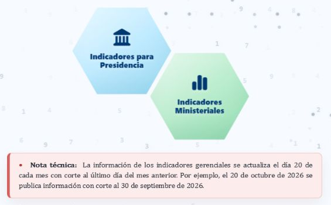{#fig-manual-1 width=100%}

# Ingreso al módulo

1. Escriba su usuario autorizado.
2. Escriba su contraseña en el campo que corresponde y pulse Ingresar.
3. Espere el mensaje de validación y la apertura del visualizador. Evite pulsar repetidamente mientras carga.
4. Si aparece un mensaje de acceso no autorizado, revise sus credenciales y solicite al administrador DNEAISNS que confirme su permiso para el módulo de Presidencia.

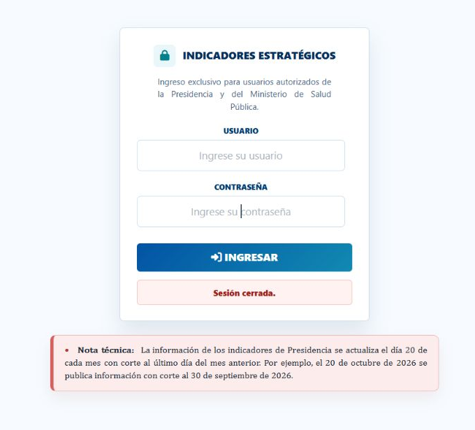{#fig-manual-2 width=100%}

Existe una nota técnica de acceso que indica una actualización el día 20 de cada mes con corte al último día del mes anterior. Para interpretar una cifra concreta, confirme además el corte visible en el tablero y sus notas metodológicas.

# Reconocimiento de la pantalla

Al ingresar se presenta el primer indicador y la sección Cifras nacionales. El panel lateral izquierdo contiene cinco botones (uno por cada indicador). Al seleccionar el indicador requerido, queda resaltado en azul y debajo aparecen las opciones Cifras nacionales, Direcciones provinciales y Ficha metodológica.

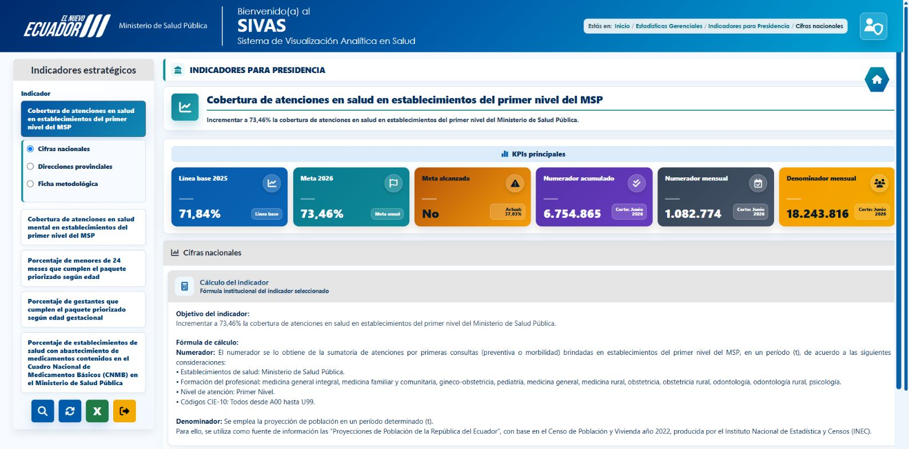{#fig-manual-3 width=100%}

Área | Qué permite revisar
--- | ---
Panel lateral izquierdo | Elegir el indicador y su sección; consultar, refrescar, descargar o salir.
Título y objetivo | Confirmar qué indicador está activo y qué busca alcanzar.
KPIs principales | Identificar referencias, metas, último valor y magnitudes del indicador.
Cifras nacionales | Consultar el cálculo o las notas, el gráfico y el detalle mensual.
Ruta Estás en | Reconocer la ubicación y regresar a un nivel anterior.

# Selección de indicadores y secciones

1. Pulse el botón del indicador que desea revisar en el panel lateral derecho.
2. Compruebe que el título central cambie y que el botón elegido esté resaltado.
3. El cambio de indicador abre Cifras nacionales y actualiza los resultados. No necesita pulsar la lupa para seleccionar el indicador.
4. Elija una de las tres opciones bajo el botón activo para abrir la sección correspondiente.

Indicador disponible | Qué se consulta
--- | ---
Cobertura de atenciones en salud en establecimientos del primer nivel del MSP | Seguimiento de cobertura con primeras consultas y población de referencia.
Cobertura de atenciones en salud mental en establecimientos del primer nivel del MSP | Seguimiento de cobertura de primeras consultas en salud mental.
Porcentaje de menores de 24 meses que cumplen el paquete priorizado según edad | Cumplimiento del paquete priorizado en menores de 24 meses.
Porcentaje de gestantes que cumplen el paquete priorizado según edad gestacional | Cumplimiento del paquete priorizado en gestantes.
Porcentaje de establecimientos de salud con abastecimiento de medicamentos contenidos en el Cuadro Nacional de Medicamentos Básicos CNMB en el Ministerio de Salud Pública | Seguimiento nacional de abastecimiento y comparación mensual con metas programadas.

En esta versión el módulo presenta información nacional de 2026. No dispone de selectores de año, mes, provincia o establecimiento para filtrar estos tableros. La opción Direcciones provinciales no equivale a un filtro geográfico habilitado.

# Lectura de los KPIs principales

Los cuatro primeros indicadores comparten seis tarjetas. Lea las etiquetas y el corte que acompaña cada cifra; un color por sí solo no reemplaza esta revisión.

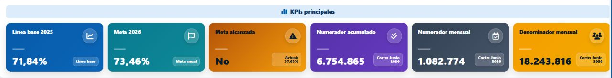{#fig-manual-4 width=100%}

Tarjeta | Interpretación para el usuario
--- | ---
Línea base 2025 | Valor de referencia para comparar el indicador.
Meta 2026 | Valor objetivo anual definido para el indicador.
Meta alcanzada | Muestra Sí cuando el último porcentaje real disponible alcanza o supera la meta anual; en otro caso muestra No. La etiqueta Actual presenta el porcentaje comparado.
Numerador acumulado | Magnitud que el sistema presenta como acumulada para el indicador seleccionado. No la sume nuevamente con los valores de otros meses.
Numerador mensual | Magnitud reportada para el último mes real disponible; no equivale necesariamente al acumulado.
Denominador mensual | Población o universo de referencia utilizado en el último mes disponible.

## Ejemplo de lectura

En la captura del primer indicador, el valor Actual es 37,03 % y la Meta 2026 es 73,46 %. El corte corresponde a junio de 2026. Estas cifras son un ejemplo de la pantalla capturada, no una certificación del valor vigente al momento de leer el manual.

Si el valor Actual no está disponible o existe una advertencia de carga, no interprete No como un resultado validado. Primero compruebe que existan datos reales en la tabla.

# Evolución mensual y detalle del indicador

1. Abra Cifras nacionales en el indicador seleccionado.
2. Revise el objetivo y el cálculo para identificar qué representan el numerador y el denominador.
3. Baje hasta Evolución mensual 2026 y compare Meta 2026 con Indicador.
4. Ubique el mes que necesita y contraste el dato del gráfico con la fila del detalle mensual.

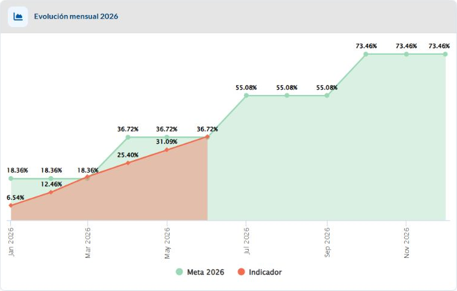{#fig-manual-5 width=100%}

El gráfico presenta dos series: Meta 2026 e Indicador. Meta 2026 muestra el porcentaje previsto para cada mes e Indicador muestra el resultado disponible. La presencia de una meta en meses posteriores no significa que ya existan resultados para esos meses. Un tramo sin dato del indicador no equivale a cero.

La tabla muestra Mes, Meta 2026, Indicador, Numerador acumulado, Numerador mensual y Denominador mensual. Incluye únicamente los meses con datos del indicador. Al incorporarse nuevos meses de 2026, aparece la meta correspondiente en las nuevas filas. El porcentaje del indicador es el resultado de la fórmula institucional. No sume los porcentajes mensuales ni vuelva a acumular una columna que ya es acumulada.

En el ejemplo de junio, el valor 37,03 % coincide con el detalle mensual; el numerador acumulado es 6.754.865 y el mensual 1.082.774. Son magnitudes distintas y deben citarse con su etiqueta y período.

La meta del primer indicador se aplica por trimestre: 18,36 % de enero a marzo; 36,72 % de abril a junio; 55,08 % de julio a septiembre; 73,46 % de octubre a diciembre. El KPI Meta 2026 conserva la meta anual de 73,46 %. Por eso un resultado puede superar la meta del mes y todavía mostrar No frente a la meta anual.

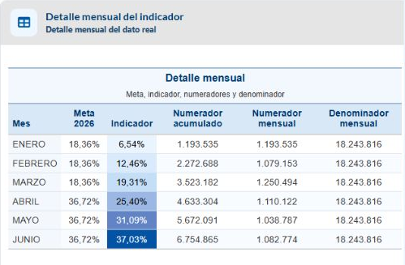{#fig-tabla-cobertura width=100%}

# Consulta de cobertura en salud mental

Seleccione Cobertura de atenciones en salud mental en establecimientos del primer nivel del MSP. Verifique que el título central se refiera a salud mental antes de interpretar los resultados.

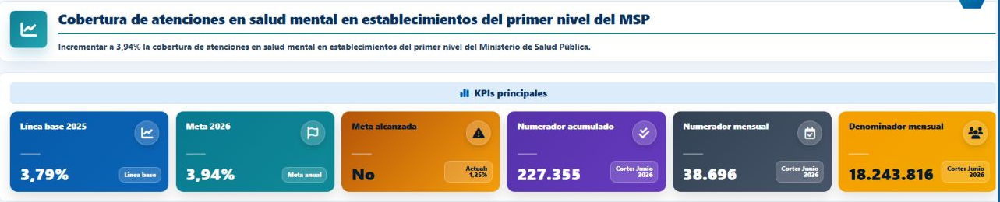{#fig-manual-6 width=100%}

El numerador corresponde a primeras consultas en salud mental, preventivas o de morbilidad, y el denominador a la proyección de población del período. Lea el detalle del cálculo y la ficha para precisar el alcance. La definición es distinta a la del total de atenciones del primer nivel, por lo que sus resultados no deben intercambiarse.

1. Revise la Línea base 2025 y la Meta 2026 del indicador de salud mental.
2. Identifique el porcentaje Actual y el corte disponible.
3. Compare la serie Indicador con Meta 2026 y contraste el mes de interés en la tabla.
4. Si necesita sustentar la interpretación, abra Ficha metodológica y consulte el documento asociado.

La operación de consulta, la lectura de las tarjetas y la descarga Excel se realizan igual que en el primer indicador. Seleccionar salud mental reemplaza los resultados visibles y la ficha por los de ese indicador.

## Metas mensuales de salud mental en 2026

La Meta 2026 anual es 3,94 %. En el gráfico y en el detalle, cada mes se compara con la programación siguiente. Estas metas son porcentajes; no son cantidades de atenciones.

| Mes | Meta 2026 | Mes | Meta 2026 |
|:---|---:|:---|---:|
| Enero | 0,34 % | Julio | 2,29 % |
| Febrero | 0,68 % | Agosto | 2,62 % |
| Marzo | 0,98 % | Septiembre | 2,94 % |
| Abril | 1,31 % | Octubre | 3,27 % |
| Mayo | 1,62 % | Noviembre | 3,61 % |
| Junio | 1,95 % | Diciembre | 3,94 % |

La tabla del aplicativo muestra únicamente meses con datos reales. Si el corte disponible es junio, las filas terminan en junio y sus metas van de 0,34 % a 1,95 %. Las metas de julio a diciembre se muestran en el gráfico como referencia y se incorporan al detalle cuando existen los datos correspondientes.

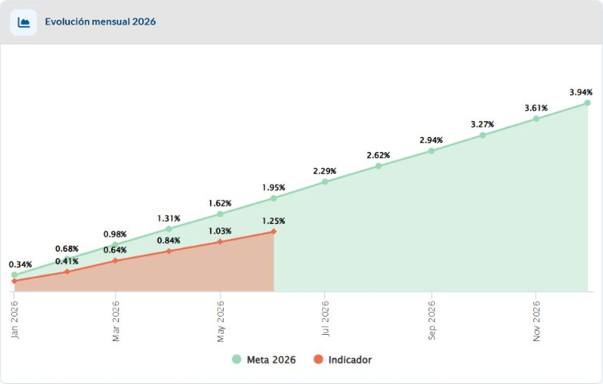{#fig-mental-serie width=100%}

{#fig-mental-tabla width=100%}

# Consulta de menores y gestantes

## Menores de 24 meses

Seleccione Porcentaje de menores de 24 meses que cumplen el paquete priorizado según edad. Revise el cumplimiento del paquete completo y el universo de menores atendidos que se utiliza como denominador; consulte la ficha para precisar los componentes y criterios.

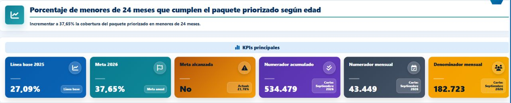{#fig-manual-7 width=100%}

## Gestantes

Seleccione Porcentaje de gestantes que cumplen el paquete priorizado según edad gestacional. Confirme la definición del paquete y el universo de gestantes atendidas antes de comparar períodos.

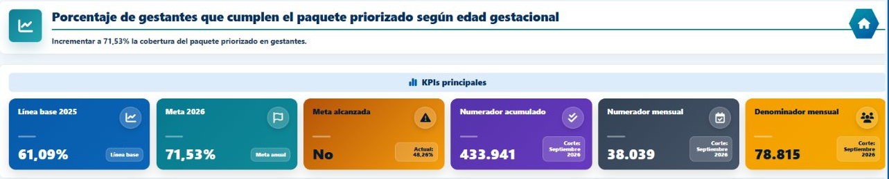{#fig-manual-8 width=100%}

En ambos casos, la tabla presenta la meta mensual, el porcentaje del indicador, los numeradores y el denominador. No interprete estas magnitudes como consultas externas del primer indicador. Para análisis o reportes, mantenga el nombre del indicador, el corte y la definición de su ficha.

# Consulta de abastecimiento de medicamentos

Seleccione el quinto indicador, cuyo título se refiere al porcentaje de establecimientos con abastecimiento de medicamentos. Esta pantalla tiene una estructura de resumen y notas distinta a los cuatro indicadores anteriores.

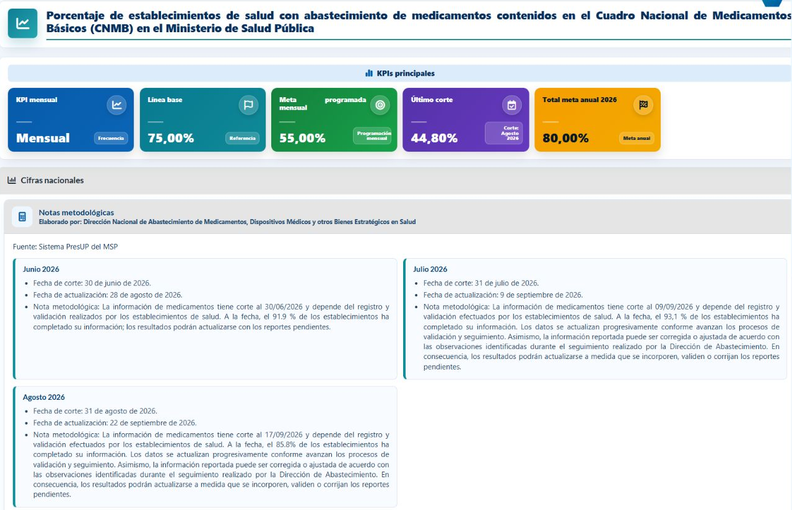{#fig-manual-9 width=100%}

Sus tarjetas muestran KPI mensual, Línea base, Meta programada mensual, Último corte y Total meta anual 2026. La tarjeta Último corte identifica el porcentaje y el mes del dato real más reciente. Para comparar un mes específico con su programación, use la fila de ese mes en el Cuadro comparativo.

En Notas metodológicas, revise por cada mes la fecha de corte, la fecha de actualización y las advertencias sobre registro y validación de información. Los resultados pueden revisarse cuando se incorporen o corrijan reportes pendientes.

La publicación mensual de medicamentos tiene una regla específica: un corte se habilita desde el día 21 del mes siguiente. Esta regla no garantiza que exista un dato cargado para todos los cortes; revise siempre lo que efectivamente aparece en pantalla.

# Comparación mensual de medicamentos

1. Mantenga seleccionado el indicador de medicamentos y abra Cifras nacionales.
2. Baje al gráfico y al Cuadro comparativo.
3. Seleccione para su análisis una fila con meta alcanzada disponible.
4. Compare la meta alcanzada y la programada del mismo mes; revise las notas del corte antes de concluir.

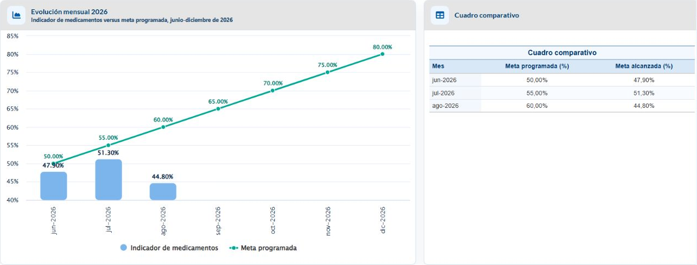{#fig-manual-10 width=100%}

Las barras corresponden al indicador de medicamentos y la línea a la meta programada. La programación abarca junio a diciembre de 2026. La tabla presenta únicamente los meses con dato real y contiene Mes, Meta programada y Meta alcanzada.

## Ejemplo de comparación

La captura muestra para agosto de 2026 una meta programada de 60,00 % y una meta alcanzada de 44,80 %. La diferencia es −15,20 puntos porcentuales, calculada como 44,80 menos 60,00. No la describa como una caída del 15,20 % ni utilice una meta de otro mes para esa comparación.

La tarjeta de resumen Meta programada mensual no sustituye la programación por mes del cuadro. Cuando el objetivo sea valorar un corte concreto, cite los dos valores de la fila correspondiente junto con el mes.

# Direcciones provinciales y fichas metodológicas

## Direcciones provinciales

Al seleccionar Direcciones provinciales se abre una sección En construcción. En la versión revisada todavía no ofrece resultados por dirección provincial. Este mensaje no indica un error de sus credenciales ni ausencia de registros nacionales.

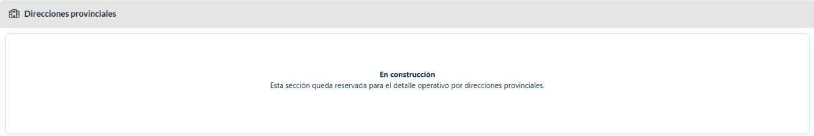{#fig-manual-11 width=100%}

## Ficha metodológica

1. Seleccione uno de los cuatro primeros indicadores.
2. Elija Ficha metodológica bajo el botón activo.
3. Confirme que el nombre de la ficha corresponda al indicador seleccionado.
4. Consulte el PDF en el visor o pulse Descargar ficha para guardarlo.

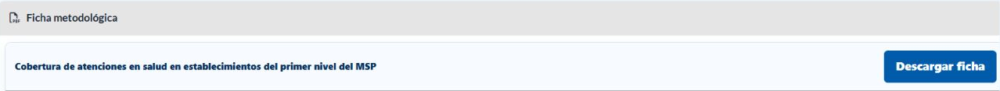{#fig-manual-12 width=100%}

La visualización embebida depende del visor PDF del navegador. Si el área aparece vacía, pruebe la descarga y abra el archivo con un lector PDF. La ficha del indicador de medicamentos figura En construcción y no ofrece descarga en esta versión.

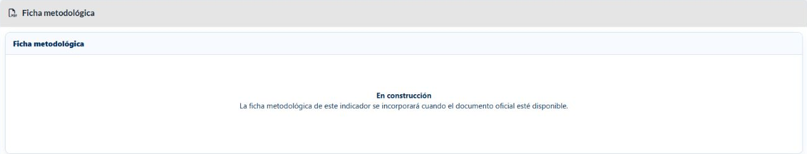{#fig-manual-13 width=100%}

# Acciones de consulta y descarga

Los cuatro botones se encuentran en la parte inferior del panel lateral. Puede ser necesario desplazarse para verlos si la pantalla es pequeña.

{#fig-manual-14 width=45%}

Control | Efecto
--- | ---
Consultar — lupa azul | Recarga la información desde las fuentes configuradas. Espere a que termine la carga.
Refrescar — flechas circulares | Regresa al primer indicador y abre Cifras nacionales. No equivale a recargar las fuentes.
Descargar — X verde | Genera el Excel de datos reales del indicador activo.
Salir — puerta amarilla | Cierra la sesión del módulo y devuelve al formulario de ingreso.

## Descargar los datos en Excel

1. Seleccione el indicador que desea exportar y compruebe su título.
2. Pulse el botón verde X.
3. Guarde el archivo .xlsx en la ubicación elegida por el navegador.
4. Abra la hoja Datos y confirme el nombre del indicador y los meses antes de usar la información.

Para los cuatro primeros indicadores, el Excel incluye Indicador, Mes, Meta 2026 (%), Indicador (%), Numerador, Numerador mensual y Denominador mensual. Para medicamentos incluye Indicador, Mes, Meta programada (%) y Meta alcanzada (%). La descarga depende del indicador activo, no de la sección del acordeón que esté abierta.

El Excel es una extracción de los datos del momento de la consulta; una descarga anterior no se actualiza por sí sola cuando cambian las fuentes. Registre la fecha de extracción y mantenga el archivo dentro de los canales institucionales autorizados.

# Retorno y cierre de sesión

## Navegar hacia un nivel anterior

La ruta Estás en muestra la ubicación actual. Pulse un segmento anterior para volver a ese nivel, o use el botón institucional de retorno para retroceder un paso en la navegación. Estos controles no equivalen a Refrescar.

Si abandona el módulo de Presidencia, la sesión local del módulo se cierra; al volver se solicitan credenciales nuevamente. No use el botón Atrás del navegador como sustituto del cierre de sesión.

## Terminar una consulta

1. Complete las descargas que necesita y compruebe que se hayan guardado.
2. Pulse Salir en el panel lateral.
3. Confirme el retorno al formulario y el mensaje Sesión cerrada.
4. Cierre la pestaña cuando termine, especialmente si utiliza un equipo compartido.

## Revisión antes de incorporar una cifra a un informe

1. Anote el nombre completo del indicador y su alcance nacional.
2. Compruebe el mes de corte; no lo sustituya por la fecha de hoy.
3. Diferencie porcentaje, numerador mensual, numerador acumulado y denominador.
4. Revise la ficha y las notas metodológicas; en medicamentos compare valores del mismo mes.
5. Conserve el Excel de respaldo y la fecha de extracción.

Compartir resultados requiere mantener el contexto del dato. Una captura aislada de una tarjeta puede omitir el período, el indicador o una advertencia metodológica que cambie su interpretación.

# Preguntas frecuentes y soporte

Situación | Qué hacer
--- | ---
Aparece Ingrese usuario y contraseña | Complete ambos campos y pulse Ingresar una vez. Espere la respuesta.
Las credenciales no permiten ingresar | Revise la escritura y solicite al administrador validar el permiso activo para Presidencia. No confunda el acceso al servidor con el del aplicativo.
Solo aparece la serie planificada | Revise los mensajes y la disponibilidad de datos reales. Use Consultar; si el problema persiste, comuníquelo al soporte institucional.
El último mes visible no es el mes actual | Compruebe el corte publicado. No suponga que falta información solo por compararlo con la fecha de hoy.
Direcciones provinciales indica En construcción | Continúe con Cifras nacionales. El detalle provincial aún no está habilitado.
No veo el PDF o no hay Descargar ficha | Compruebe el indicador: medicamentos no tiene ficha habilitada. En los otros cuatro, pruebe la descarga si falla el visor.
No encuentro el archivo Excel | Revise la lista y la carpeta de descargas del navegador. Confirme que la sesión siga activa.
La imagen o los controles no caben | Amplíe la ventana o use el desplazamiento. Mantenga un zoom que permita leer títulos, cifras y corte.

## Información útil para solicitar soporte

Informe el módulo, el indicador, la sección, la fecha y hora de la consulta, el período que esperaba revisar y el mensaje exacto. Adjunte una captura que muestre el contexto. No envíe la contraseña ni incluya datos ajenos al problema.

# Glosario y consulta rápida

Término | Significado en el manual
--- | ---
Indicador | Medida que permite seguir un aspecto definido de atención o cumplimiento.
KPI | Tarjeta de resumen con una referencia, una meta o una magnitud del indicador.
Línea base | Valor de referencia frente al que se analiza el seguimiento.
Meta programada | Valor previsto para el período correspondiente.
Dato real | Resultado disponible en la fuente para un mes.
Corte | Período o fecha a la que corresponde la información.
Numerador y denominador | Magnitudes utilizadas en la fórmula del indicador.
Punto porcentual | Diferencia aritmética entre dos porcentajes.
Ficha metodológica | Documento que precisa la definición y forma de medición del indicador.
Acordeón | Sección que se abre o se cierra al elegir su encabezado u opción lateral.

## Secuencia de consulta recomendada

Ingresar → elegir indicador → confirmar corte y datos reales → revisar cálculo o notas → contrastar gráfico y tabla → consultar ficha → descargar si corresponde → salir.

## Referencia de esta edición

Manual elaborado sobre el Módulo de Indicadores de Presidencia, por la Dirección Nacional de Estadística y Análisis de la Información del Sistema Nacional de Salud (DNEAISNS).
